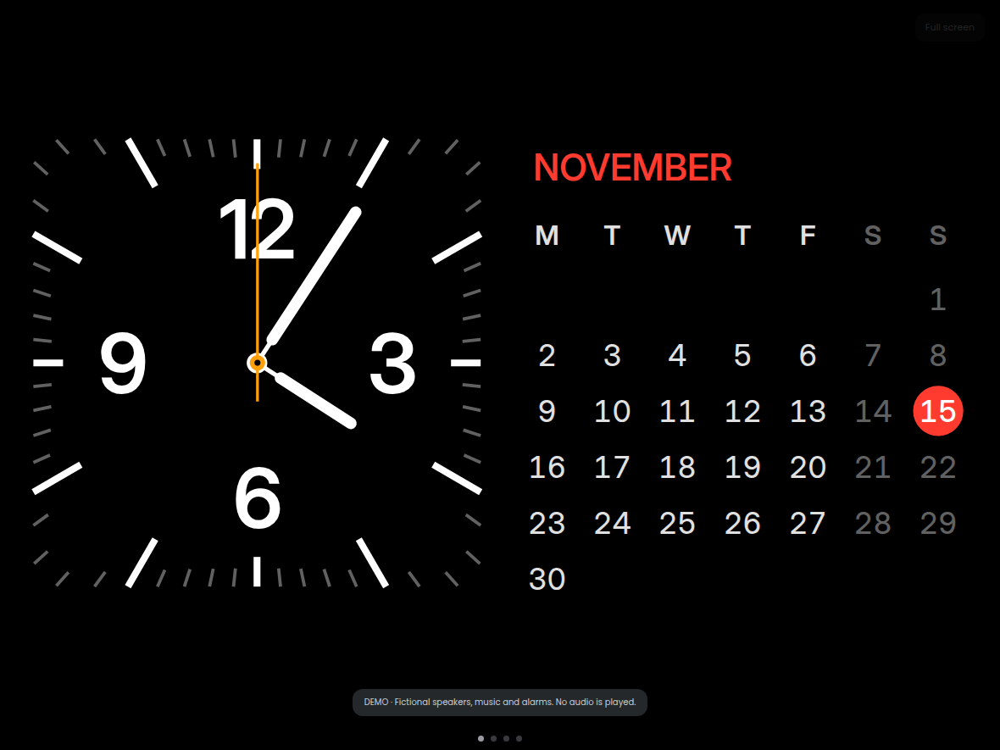
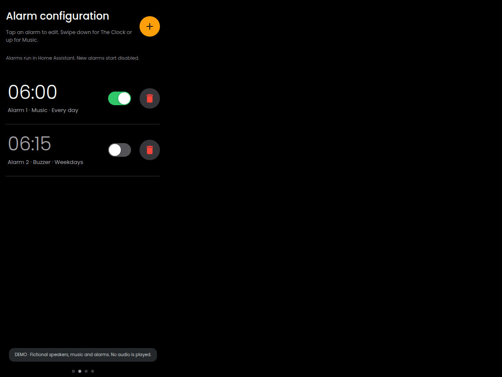
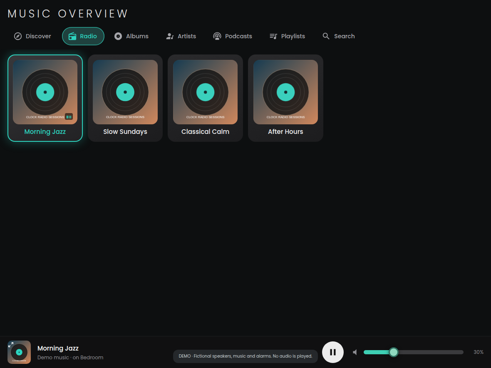
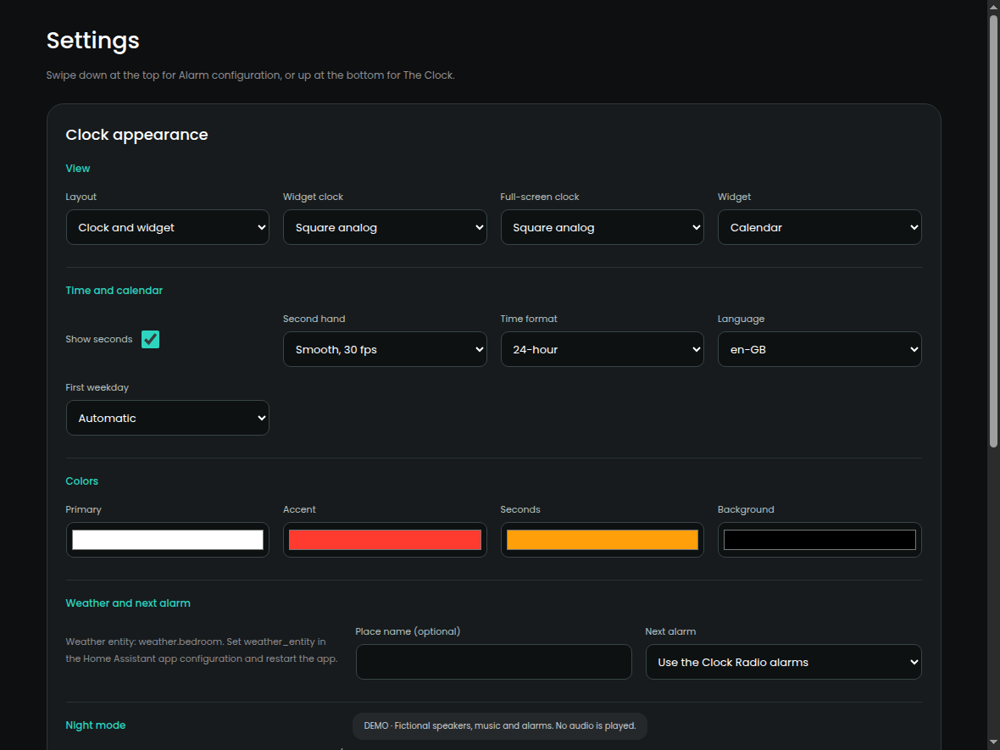

# Clock Radio - Home Assistant app

[](https://github.com/JannicSJensen/ha-clock-radio/actions/workflows/ci.yaml)
[](https://my.home-assistant.io/redirect/supervisor_add_addon_repository/?repository_url=https%3A%2F%2Fgithub.com%2FJannicSJensen%2Fha-clock-radio)

A calm bedside clock and radio dashboard, built on the same concept as
[Dasher](https://github.com/JannicSJensen/ha-dasher-addon): a standalone Home
Assistant app (add-on), a small Node.js server, and a vanilla JavaScript tablet
page with no build step, HACS cards, or tablet-side Home Assistant token.

## Four pages

1. **The Clock** - the layouts and widgets from
   [nightstand-clock](https://github.com/taclab/nightstand-clock): square/round
   analog and digital clocks, calendar, weather, date, date/calendar and
   full-screen faces. Includes seconds/sweep modes, locale/week-start settings,
   colors, next alarm and sun/scheduled/entity/room-light night modes.
   While either alarm type is snoozed, the widget becomes a live countdown with
   the same slide-to-stop control as the ringing screen.
2. **Alarm configuration** - existing HA alarm
   profiles: Music/Buzzer type, independent wake times, weekdays, volumes and
   wake timers. A compact list offers enable switches; tap a time to edit with
   hour/minute wheels and circular repeat-day buttons. Music alarms offer
   Music Assistant radio logos below Alarm type, with a separate saved station
   for each alarm (HA package version 5). Buzzer alarms offer twelve original
   sounds with independent choices and browser previews (HA package version 7).
   Install the
   [alarm package](examples/home-assistant/README.md)
   once; **Add alarm** creates additional persistent HA helpers and timers.
   New alarms start disabled; existing profiles are not duplicated. **Delete**
   confirms removal and stops/cancels that alarm. Bundled YAML profiles are
   disabled/hidden; app-created native helpers are removed.
3. **Music overview** - Dasher's layout with swipeable Discover,
   Radio, Albums, Artists, Podcasts, Playlists and Search tabs, sticky
   now-playing bar and artwork player with seeking, shuffle, repeat and volume.
   Full library browsing needs a Music Assistant read-only token in app options.
4. **Settings** - persistent clock appearance, time/calendar, weather labels,
   night mode and Music Assistant connection guidance.

All four main-page canvases default to pure black; cards and controls retain
their contrast. Clock colors remain configurable in Settings.

There is no menu. Swipe **up/down** between pages; scroll to the edge first in
Alarm configuration/Music/Settings. Keyboard users can use **Page Up/Down**.
Four dots at the bottom show which page you are on; the active dot is grey.
On the split clock,
swipe **left/right** within each panel to save its clock face or widget.
Full-screen faces and hiding the widget remain Settings options.

After two minutes of inactivity on Alarm configuration, Music or Settings, the
clock returns automatically. Configure `return_to_clock_minutes` in the HA app
options (`0` disables it) and restart. Activity restarts the countdown; open
dialogs and pending saves pause it. Music continues and Settings drafts remain.

Clock settings and alarm definitions also persist as read-only browser
snapshots, with explicit offline/last-sync status and bounded requests.
No changes are queued or replayed; HA is still required to execute alarms.
See [offline behavior and limits](clock-radio/DOCS.md#offline-snapshots-and-request-deadlines).

Set `media_player` in the HA app configuration: Music and every alarm use that
one speaker, without player selection, grouping or Party.
Set `weather_entity` there as well and restart the app to enable weather in
the widget and full-screen clock. Weather selection is not in dashboard Settings.
For automatic night colors, select **Sun (below horizon)** in Settings' Night
mode. Set `sun_entity` in the HA app configuration if needed (default `sun.sun`).
It follows that entity without an automation or fixed schedule.
For manual color testing, the optional
[HA night-override helper](examples/home-assistant/clock_radio_night_mode.yaml)
offers **Auto / Day / Night** without replacing your automatic night-mode setup.

## Screenshots

These landscape screendumps show the app with configured, fictional demo data.
No real Home Assistant data, credentials or audio are used. Your entities,
station logos and clock appearance may differ.

| The Clock: analog face and calendar | Alarm configuration: independent profiles |
| --- | --- |
|  |  |
| **Music overview: Radio and now-playing bar** | **Settings: iOS-inspired dark appearance** |
|  |  |

The [illustrated configuration guide](clock-radio/DOCS.md) also shows the alarm
editor and radio picker, both ringing-alarm screens, Sun night-mode settings and artwork player.

## Foundation

- Ingress sidebar access and a separate tablet page on port **8100** (Dasher
  remains on 8099, so both apps can run together).
- Supervisor-provided credentials, server-side command restrictions, read-only
  mode and explicit connection/configuration errors.
- Persistent `dashboard.yaml`, seeded on first start and reloaded within five
  seconds. Invalid edits show an error and retain the last valid configuration.
- A fictional local demo, automated tests, app linting and image-build CI.

Room-light mode reads an **HA illuminance sensor**, not an Android hardware
sensor. Alarms run inside HA, even with the tablet closed. Opening the app does
not enable alarms or reset their times. Changing the configured media player
safely updates the shared HA speaker helper. Playback happens on your HA
speaker, not the tablet. The ordinary artwork player opens only when requested.
Ringing alarms automatically open a dedicated large-time screen: Music adds a
mini player, and both types offer slide-to-stop and HA-backed 10-minute Snooze.
Install/update the [HA alarm package](examples/home-assistant/README.md) for Snooze;
the previous page returns when the alarm ends.

## Install

Requires Home Assistant OS or a Supervisor installation on amd64 or aarch64.

1. Open **Settings > Apps > App store > Repositories** (called **Add-ons** on
   older versions).
2. Add `https://github.com/JannicSJensen/ha-clock-radio`.
3. Install **Clock Radio**, start it and choose **Open web UI**.
4. Configure alarms in **Alarm configuration**, the clock in **Settings**, and
   optional radio presets in
   the app's `dashboard.yaml`; see
   [settings and examples](clock-radio/DOCS.md).
5. On a tablet, open `http://<home-assistant>:8100/`.

The image is built locally by Supervisor; an external container registry is
not required. For ingress-only access, disable the 8100 host-port mapping in
the app's Network settings.

**Trust boundary:** the direct tablet page has no login, like Dasher. Anyone
able to reach port 8100 can see the configured player information and control
allowed players, edit dashboard settings and change the Clock Radio alarm
helpers. Keep it on a trusted LAN; do not expose it to the internet.
Use ingress for authenticated access. Empty `players` allows all discovered
media players; explicitly list players to narrow control.

## Development

```sh
cd clock-radio/app
npm ci
npm run dev
# Open http://localhost:8100/ (fake HA, no real audio or HA access).
```

The demo creates ignored configuration under `clock-radio/app/dev/config/`.
It starts fictional HA and Music Assistant APIs on a free loopback port and
stops them when the app exits. Both demo alarms start disabled.
`PORT=8101 npm run dev` selects another dashboard port.
`DEMO_ALARM=Buzzer npm run dev` or `DEMO_ALARM=Music npm run dev` starts a
fictional ringing alarm for testing the dedicated screen and Snooze.

Documentation images live in `docs/screenshots/`. Retake them with the demo
after UI changes, using a consistent landscape viewport and waiting for fonts
and artwork to load. Use only fictional demo data, never a real HA installation
or credentials.

For real Home Assistant development:

```sh
export HA_URL=http://homeassistant.local:8123
read -rs -p 'HA token: ' HA_TOKEN; echo
export HA_TOKEN
CONFIG_DIR="$HOME/.config/ha-clock-radio" npm start
```

Keep tokens out of files and source control. This real configuration folder is
outside the repository and separate from the demo. Do not reuse the demo
station URLs for real playback; they are fictional.

```sh
npm run check
npm test
docker build --build-arg BUILD_VERSION=0.6.0 --build-arg BUILD_ARCH=amd64 ../
```

## Layout and releases

```text
repository.yaml                  Home Assistant app-store repository
clock-radio/
  config.yaml, Dockerfile        Supervisor definition and image
  run.sh, translations/          startup and app options
  README.md, DOCS.md, CHANGELOG.md
  app/
    src/                         configuration, HA API, policy and HTTP server
    web/                         standalone clock/radio dashboard
    examples/dashboard.yaml      first-run configuration
    dev/, test/                  fake HA and automated tests
.github/workflows/ci.yaml         tests, app linter and Docker build
docs/screenshots/                fictional demo screendumps for documentation
```

For user-visible changes, run `npm version <version> --no-git-tag-version` in
`clock-radio/app/`, update `clock-radio/config.yaml`, and add a matching release
heading to `clock-radio/CHANGELOG.md`. Commit the feature and version together.
Tests enforce agreement between app, package, lockfile and changelog versions.
Push to `main`, then refresh the HA app store to see updates. User configuration
is never overwritten on upgrade; see the example file for new settings.

## Foundation and license

Based on the packaging and dashboard concept of
[JannicSJensen/ha-dasher-addon](https://github.com/JannicSJensen/ha-dasher-addon)
(MIT). Focused music components and Poppins fonts are reused from Dasher; no
unrelated pages or private configuration are bundled. HA state uses five-second
REST polling, with a short-lived WebSocket request for MA integration discovery.
Dasher source revision: `36702c2cb4c2a9691acb53220c33ce10b32ac091`.

Clock rendering and fonts are adapted from
[taclab/nightstand-clock](https://github.com/taclab/nightstand-clock)
([Apache-2.0](clock-radio/app/web/clock/LICENSE)). Modifications add app-timezone
support, live HA weather/alarms/night data and a visibility bridge. Bundled fonts
retain their [Inter](clock-radio/app/web/clock/fonts/OFL.txt),
[Archivo](clock-radio/app/web/clock/fonts/OFL-Archivo.txt) and
[Poppins](clock-radio/app/web/fonts/LICENSE.txt) SIL Open Font Licenses.
Nightstand source revision: `6adb688d95efce91f2cd81ae28b5feed4af96c70`.

[MIT license](LICENSE).
