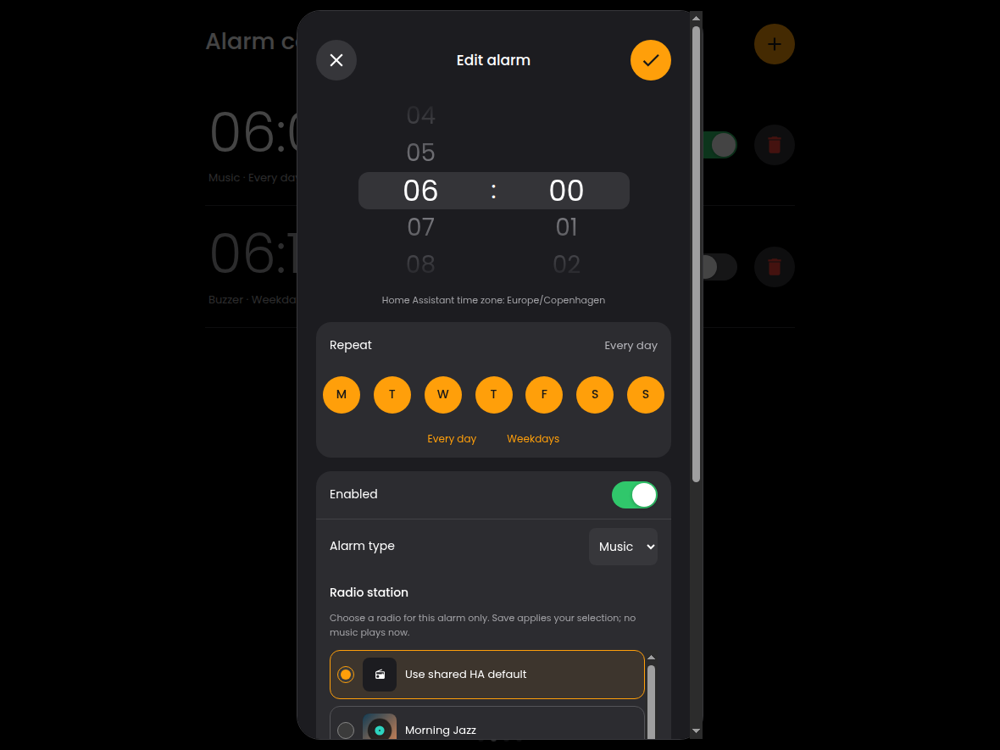
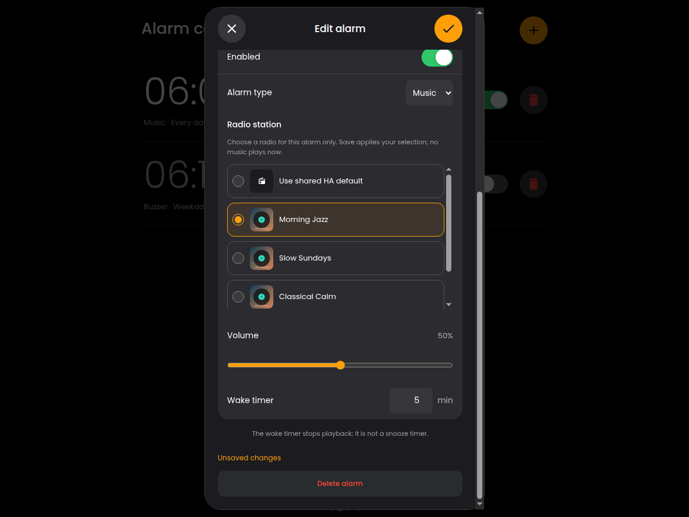
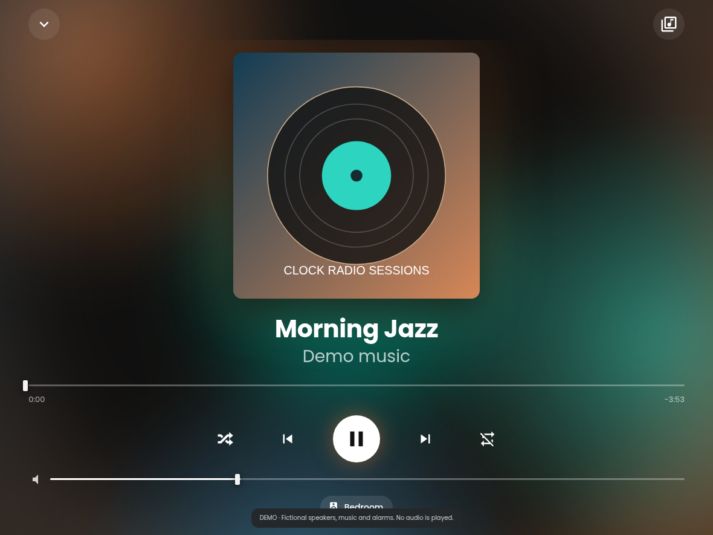

# Clock Radio configuration

## Four pages and alarm helpers

All four main-page canvases and the app/loading background are pure black
(`#000000`). Cards, controls and dialogs keep contrasting surfaces; clock
colors can still be customized in Settings.

There is no menu. Swipe **up/down** between **The Clock**, **Alarm configuration**,
**Music overview** and **Settings**, or use keyboard **Page Up/Down** outside
form inputs. Scroll to the top/bottom first in Alarm configuration, Music and
Settings: ordinary scrolling never changes pages mid-scroll. Open player dialogs
and sliders do not trigger page swipes.
Four dots at the bottom of every main page show your position, left to right:
Clock, Alarm configuration, Music, Settings. The active page has a grey dot;
the other dots are darker. They are position indicators, not buttons. Screen
readers announce the page name and position, such as "Page 4 of 4: Settings".
Swipe left/right within the split clock's left panel to cycle square analog,
round analog and digital faces; the right panel cycles calendar, weather, date
and date/calendar. These selections save to YAML. Full-screen faces and hiding
the widget remain Settings options. Swipes cannot save views in read-only mode.

See the [four-page screenshot gallery](../README.md#screenshots) for the Clock,
Alarm configuration, Music overview and Settings. All screendumps below use
fictional demo data, not a real HA installation.

See the [Home Assistant alarm package](../examples/home-assistant/README.md) for
two independent Music/Buzzer alarm profiles and native entities cards. Install
that package separately in Home Assistant. Alarm configuration edits the existing
`clock_radio_alarm_N_*` helpers, including enabled state, type, wake time, seven
weekdays, volume (0-100%) and wake timer (1-120 minutes). Profiles may
use different times, durations and Music radio stations; all use the configured
app speaker. Missing/unavailable helpers are shown explicitly and cannot be saved.
Configure the shared default Music source and Buzzer source helpers in HA as
described in the alarm package setup; these shared defaults are not editable
in the app.

Alarm configuration shows a compact list with large wake times and immediate
enable switches. Alarms are identified by time, type and repeat days rather
than numbered names; internal HA profile/helper IDs are unchanged.
Setup/deletion warnings appear only when action is needed.
Tap an alarm to open its editor. Scroll the hour/minute wheels
or use Arrow Up/Down, Home/End and Page Up/Down while a wheel is focused.
The wheels follow the clock's 12/24-hour setting; 12-hour mode includes AM/PM.
The displayed HA time zone always determines the schedule, not the tablet's zone.
Choose circular repeat weekdays, or use **Every day** / **Weekdays** shortcuts.
An enabled alarm requires at least one selected day; no days does not mean
a one-shot alarm.


The editor groups the existing Enabled, Music/Buzzer, volume (0-100%) and wake
timer (1-120 minutes) controls. The wake timer stops playback and is **not Snooze**.
No label or per-profile snooze fields are added. **Save** applies changes and closes;
**Cancel** or **Escape** discards the draft without writing to HA. Drafts survive
polling; page swipes and keyboard page navigation are blocked while editing.
Direct navigation away from `#alarms` closes the editor without saving.
Save errors remain visible in the editor, with **Reload saved values** to inspect
HA's actual state. Missing, invalid or incomplete helpers cannot be edited or
enabled; additional incomplete profiles still offer **Finish setup**.

The editor shows the time wheels, repeat-day shortcuts and existing profile
controls. Scroll inside the editor if controls do not fit your screen.



### Music alarm radio station

When **Alarm type** is **Music**, a **Radio station** list appears directly below
it, showing Music Assistant radio names and logos. Click/tap a radio to select
it **for this alarm only**, then **Save alarm**. Selection does not start music.
The radio list comes through HA's Music Assistant integration; a separate MA
browsing URL/token is not required.



**Use shared HA default** clears this alarm's override and uses
`input_text.clock_radio_music_source`. Existing alarms keep this default until
you save a station. **Cancel** discards the station draft. Switching to Buzzer
hides the list without losing its selection; Buzzer still uses its shared sound.
The saved radio also applies when that Music alarm resumes from Snooze.
Draft station choices survive polling without moving keyboard focus.

Install/reload scheduler package **version 5**, including
`input_text.clock_radio_alarm_1_music_source` and
`input_text.clock_radio_alarm_2_music_source`. These restoring, maximum-255-character
helpers must not have `initial` values. Newly created profiles include their own
source helper; existing app-created profiles receive it through HA's admin-only
API when their first station choice is saved. Do not reset initialization flags.
Older packages can still edit existing alarm settings but cannot choose a station.

An empty or failed library shows an explicit message. Add radios to Music
Assistant's library; normal radio refresh is every five minutes (one minute after
an error). A previously saved station missing from the current library remains
selected and is not silently replaced. Choose a different station or the shared
default to change it; unrelated edits preserve it. Unavailable source helpers
must be restored in HA before choosing a station.

Saving a profile temporarily disables its schedule while the individual HA
helpers are updated, then applies the requested enabled state. If a write
fails, the app reports that the edit was incomplete; inspect the profile before
enabling it. Existing enabled states and helper values are not initialized or
reset just by opening the app. Native HA entities cards continue to work.
Configured-speaker changes temporarily pause enabled schedules and restore them
only after the speaker helper is saved. Conflicting edits are rejected;
failed edits immediately refresh the actual HA values rather than reporting success.

**Add alarm** with the current package creates 14 settings helpers (including
the per-profile Music source), a persistent initialization flag and a
restoring timer using HA's admin-only helper APIs. Fresh profiles default to
Music, 06:00, Monday-Friday, 50% and five minutes, **disabled**. Find this action
and profile controls on **Alarm configuration**. **Settings** contains
clock appearance and Music Assistant guidance. Direct links `#alarms` and
`#settings` open the respective pages; unsaved clock-form edits survive page changes.
Add alarm creates the disabled HA profile immediately and opens its editor.
Cancel leaves that new profile in HA, disabled, without applying draft edits.
The dynamic HA
package must expose `sensor.clock_radio_alarm_scheduler_version` >= 2 and have
available playback/stop scripts before creation is offered. The radio picker
additionally requires version 5 and its new bundled source helpers; saved values
and existing helper definitions are preserved.
Partial setup is explicitly reported and can be resumed with **Finish setup**;
existing helper edits are not overwritten. Review resumed values before enabling.
An incomplete profile is never scheduled. Helpers, times and timers remain in
HA after app restarts and work with the tablet/app closed.

## Deleting alarms

Use the red trash button on an alarm row or **Delete alarm** in its editor.
The confirmation defaults to **Keep alarm**. Keep alarm or Escape cancels
without changing HA or losing an editor draft. Incomplete profiles can also
be deleted. Read-only, disconnected and conflicting busy controls are disabled.


Deletion stops/cancels only that profile's ringing playback, wake timer or
pending Snooze; it does not stop ordinary music or another profile's alarm.
For **app-created profiles**, HA's admin-only native helper APIs remove the
profile's settings, initialization flag and timer. For **bundled Alarm 1/2**,
their YAML definitions cannot be removed through runtime helper APIs: deletion
persistently disables and hides them instead. Their YAML helpers remain in HA,
but scheduled/manual starts and Snooze resumption are blocked.

Install/reload the current [HA package](../examples/home-assistant/README.md),
including scheduler version **5**, its deletion helpers and preparation script.
Existing saved settings and initialization flags must not be reset.
Older packages retain their existing controls but cannot Delete.

If a deletion fails, its profile remains visible and disabled with a pending
deletion message. Check the reported HA permissions/helper or speaker error
and **retry Delete**. Do not use Finish setup to resurrect a partial deletion.
Complete the pending deletion before adding or deleting another profile.
The HA deletion marker restores across restarts so a partially removed profile
cannot begin playing before recovery.

## Ringing alarms and Snooze

A dedicated screen automatically takes over when an HA alarm rings, including
when opening the app during an alarm. Buzzer alarms show a large clock and
orange **Snooze** button. Music alarms also show a compact artwork/metadata
player with supported play/pause, previous/next and volume controls. The time
uses the clock's locale, time zone and 12/24-hour setting.
Ordinary music playback never opens this screen.

| Buzzer alarm | Music alarm with mini player |
| --- | --- |
|  |  |

Drag the **slide to stop** knob at least 90% across and release to stop the
alarm. Partial/cancelled gestures reset; tapping the track does not stop it.
Keyboard users can press End (or Arrow Right repeatedly), then Enter/Space.
Stop uses the HA alarm script, cancelling timers and restoring volume/repeat,
not merely pausing the speaker. The screen stays until HA confirms the alarm
ended; failures are shown on-screen. Read-only/disconnected controls are disabled.
Page navigation and Escape cannot dismiss a ringing alarm. When it ends, the
previous page returns; an interrupted alarm-editor draft is discarded.

**Snooze** silences either alarm type and rings again in **10 minutes**, even
with the app/tablet closed. A pending snooze appears in Alarm configuration
with **Cancel snoozed alarm** and contributes to the clock's next-alarm display.
A new alarm replaces a pending snooze. Resuming uses the captured Music/Buzzer
type with the profile's current duration/volume and current shared speaker/source.
No schedule is enabled or disabled by snoozing.

For reliable captured ringing state and Snooze, replace the installed HA package
with the current version (scheduler version **5**), including the new text and
date/time helpers. Check configuration and reload helpers, scripts, templates
and automations; restart HA if `input_datetime` was not previously loaded.
Do not rerun/reset initialization flags. Older packages still support the
ringing screen when exactly one alarm timer and an active speaker identify it,
but Snooze is disabled with an upgrade message.
The Snooze deadline survives HA restarts: future snoozes remain pending, and
an overdue snooze rings once when HA starts again. Ordinary alarms missed while
HA was down are not replayed.

## First start

The app copies its example to `/config/dashboard.yaml` inside the container.
This is the app-specific configuration directory, **not** Home Assistant Core's
`configuration.yaml` directory. On current Supervisor installations, it is
available to appropriately configured editors/Samba under
`/addon_configs/<repository-id>_clock_radio/`. Open the Clock Radio app's folder
and edit `dashboard.yaml`. You do not need to modify HA YAML.

Changes are applied within five seconds without restarting. Invalid YAML or
settings are reported in the app log and dashboard; the last valid version
stays active. Invalid configuration on startup prevents the app from starting.
Existing files are never replaced by the example, including during app upgrades.
The Settings clock form atomically writes only the `clock` section, preserving
the remaining settings and YAML comments. It refuses to overwrite invalid YAML.

## Dashboard settings

```yaml
title: Bedroom Radio
locale: en-GB
time_zone: Europe/Copenhagen
clock_24h: true
show_seconds: false
stations:
  - id: favourite
    name: My favourite station
    media_content_id: "https://your-station.example/live.mp3"
    media_content_type: music
    source: home_assistant
```

Replace the example stream URL with a real, authorized station stream. A web
page containing a player is not usually a stream URL. Your selected speaker
must be able to reach and decode the URL. The app itself does not fetch streams.

| Setting | Default | Meaning |
| --- | --- | --- |
| `title` | `Clock Radio` | Dashboard heading and browser title. |
| `locale` | `en-GB` | Music labels (English/Danish) and legacy clock locale. |
| `time_zone` | `""` | IANA time zone, e.g. `Europe/Copenhagen`; empty follows HA. Alarm schedules always use HA's zone. |
| `clock_24h` | `true` | Legacy time-format default when `clock.time_format` is absent. |
| `show_seconds` | `true` | Legacy seconds default when `clock.seconds` is absent. |
| `players` | `[]` | Legacy field; superseded by the app's `media_player` option. |
| `default_player` | `""` | Legacy field; does not override the configured app speaker. |
| `stations` | `[]` | Presets with unique lowercase `id`, `name`, and `media_content_id`; shown alongside MA library radio. |
| `clock` | See below | Clock appearance and live-data sources; saved by Settings. |

### Clock views and options

The renderer is adapted from [nightstand-clock](https://github.com/taclab/nightstand-clock).
The widget layout offers square analog, round analog and digital faces with
calendar, weather, date, date/calendar or no widget. Portrait stacks the panels.
Full-screen analog extends its dial to the screen edges; full-screen digital
uses oversized digits with date/weather and the next alarm.

| `clock` key | Values / default |
| --- | --- |
| `layout` | `widget` (default), `full` |
| `face` | `analog` (default), `analog-round`, `digital` |
| `full_face` | `analog` (default), `digital` |
| `widget` | `calendar` (default), `weather`, `date`, `date-calendar`, `none` |
| `seconds` | Boolean; default `true` |
| `second_hand` | `"60"`, `"30"` (default), `tick` |
| `time_format` | `automatic`, `24-hour` (fallback default), `12-hour`; first-run example uses automatic |
| `language` | Empty: device locale; `en`, `fr`, `de`, `es`, `it`, `pt`, `nl` or a valid locale. Existing `locale` is inherited when this key is absent. |
| `week_start` | `automatic` (default), `monday`, `sunday`, `saturday` |
| `primary`, `accent`, `seconds_color`, `background` | Six-digit hex colors; defaults `#ffffff`, `#ff3b30`, `#ff9f0a`, `#000000` |
| `weather_name` | Optional place label; empty uses the HA entity's friendly name |
| `weather_entity` | Legacy key accepted for compatibility but ignored; use the HA app option |
| `next_alarm_entity` | Optional timestamp sensor or `input_datetime`; time-only helpers are daily. Empty derives the next enabled Clock Radio alarm. |
| `night_mode` | `off` (default), `always`, `schedule`, `sun`, `entity`, `illuminance` |
| `night_start`, `night_end` | Hours 0-23; defaults 22 and 7; overnight schedules supported |
| `night_entity`, `night_threshold` | HA night entity / room illuminance sensor and threshold; defaults empty and 5 |
| `night_color`, `night_brightness` | Night color and brightness 20-100%; defaults `#ff2a1f` and 70 |

Settings uses an iOS-inspired black appearance with rounded grouped lists,
trailing control values, color swatches and a seconds switch. All existing
options remain available. **Save changes** applies the clock form; the circular
reload button (**Reload values**) discards the draft and restores saved values.
The floating action bar stays above connection/error notices. Drafts and focused
controls survive background refreshes, and read-only/disconnected mode disables
changes. Use the **Alarms** and **The Clock** links at the top or the existing
swipe/keyboard navigation to change pages.

Choose **Settings > Night mode > Mode > Sun (below horizon)** to
follow the Sun entity set by `sun_entity` in **Settings > Apps > Clock Radio >
Configuration** (default `sun.sun`; empty also uses this default). Save and
restart the app after changing it. `below_horizon` enables
your night color/brightness; `above_horizon` restores the daytime colors.
Enable the HA Sun integration and configure HA's location correctly.
No automation, schedule hours, threshold or dashboard night-entity selection is required.
Existing night-entity/hour/threshold settings are preserved but ignored in Sun
mode. Horizon changes are applied on the next refresh (within five seconds).
If the sun entity is missing, unavailable or invalid, a visible warning appears
and the last known night state is retained (daytime on first start).
Sun mode is opt-in; existing night modes and settings are unchanged.

The Settings page can be scrolled to the Night mode group. The configured
**Sun entity** is shown as a read-only row. In Sun mode, the separate night-entity
selector, hours and sensor threshold shown below are not used.

### Manual clock color test

Clock Radio 0.13.0+ optionally follows
`input_select.clock_radio_night_override`, with the exact choices **Auto**,
**Day**, **Night**. This overrides only clock colors, not alarms or music.
The configured Night mode and its settings are never rewritten:

- **Auto** follows your configured Sun, schedule, entity, illuminance, always
  or off mode.
- **Day** forces your daytime primary/accent/seconds/background colors.
- **Night** forces the configured night color and brightness over black.

Create a **Dropdown** helper under **HA Settings > Devices & services > Helpers**
named **Clock Radio night override**, with those three options in that order.
Check that its entity ID is exactly `input_select.clock_radio_night_override`.
Alternatively, install the standalone
[night-mode helper package](../examples/home-assistant/clock_radio_night_mode.yaml)
using HA's packages mechanism, check configuration and reload input selects.
Restart HA if input selects have not been loaded before. Use only one definition;
do not install the package if you already created the helper another way.
No alarm package, Music Assistant integration or app configuration option is
needed for this helper.

Select **Day** or **Night** in HA to test the colors, then return to **Auto**.
Changes are picked up during normal five-second polling, including when the
dashboard is read-only.
**Settings > Night mode > Manual color test (HA)** shows the helper's current
selection; the row is informational, not another clock-form setting.
Selections restore across HA/app restarts, so remember to return to Auto after
testing. Auto is the default when the helper is first created.

Without the optional helper, existing behavior is unchanged. If an installed
helper becomes missing, unavailable or invalid, a visible warning appears and
the last valid override is retained (Auto if none has been read yet). Valid
values clear the warning. If you intentionally remove the helper, restart the
app to return to ordinary helper-free operation.


Set `weather_entity` in **Settings > Apps > Clock Radio > Configuration**, save
and restart the app. This is the only weather entity selector; the dashboard
Settings page edits the optional place label, not the weather source.
When upgrading from 0.4.0 or earlier, copy any existing `clock.weather_entity`
from `dashboard.yaml` into the HA app option. Legacy YAML still loads but cannot
enable or override weather. An empty app option disables weather.

Weather uses current HA conditions and today's daily high/low from the legacy
forecast attribute or `weather.get_forecasts`, refreshed every 30 minutes
(five minutes after an error or while today's forecast is missing).
Yesterday's high/low are never shown as today's.
Full-screen faces show a next alarm only when it is within 24 hours; scheduled
profiles are calculated in HA's timezone, including weekday and DST changes.

Room-light mode uses a selected **HA illuminance sensor**, not Android/Kiosk
hardware access. Night starts at/below its threshold and ends above threshold
+25%; numeric entity mode uses threshold +10% (at least 1) for hysteresis.
Boolean-like entities are night while `on`, `true` or `below_horizon`.
Unavailable entities retain their last night state and show a warning.
Night uses a black background and the selected color/brightness; it does not
change hardware brightness, stop device sleep, or enable a screen wake lock.

Presets accept HTTP(S) streams or `media-source://` identifiers supported by
Home Assistant's `media_player.play_media`. `media_content_type` defaults to
`music`; use the value required by your integration. URLs containing embedded
usernames/passwords are rejected. Keep all credentials out of configuration.

### Music Assistant

Install the Music Assistant integration in HA and expose the desired speaker
as a `media_player`. For a station from Music Assistant's library:

```yaml
stations:
  - id: ma-radio
    name: My Music Assistant station
    source: music_assistant
    media_content_id: "library://radio/123"
```

Replace `123` with your library radio item's actual ID. This calls the
`music_assistant.play_media` action with `media_type: radio` and
`enqueue: replace`, targeting the selected HA player. `radiobrowser://` radio
URIs and HTTP(S) streams are also accepted in this mode. Only Music Assistant
players can handle these actions. MA library radio is also read through HA
automatically, without a separate MA token.

Radio logos use the ready-made image URLs supplied by HA, without requiring MA
browsing configuration. A playing radio's exact library URI selects its station
logo for now playing and the ringing Music mini player, avoiding stale or failing
HA player-image proxies. Logos remain cached and proxied server-side; ordinary
music keeps its existing artwork source.

Discover, Albums, Artists, Podcasts, Playlists and Search use Music
Assistant's own API. Set `music_assistant_token` to a **read-only** token from
MA **Settings > Profile**. A running HA Music Assistant app is discovered via
Supervisor when no `music_assistant_url` is set; otherwise supply its HTTP(S)
address (normally port 8095). Restart after changing connection options.
Unconfigured browsing and unavailable services are shown explicitly.

The music page retains Dasher's layout and swipeable tabs,
recommendations, sorting/favorites/filtering, item detail/track lists, queue
actions, search and the full-screen artwork player. Speaker selection, grouping
and Party are removed.
Seeking/previous/next/shuffle/repeat/volume depend on player capabilities.
The artwork player opens on request, never automatically over the clock.
The HA app's configured media player is the only playback/volume target.
Old per-device speaker preferences cannot override it.

Tap the now-playing artwork or title to open this full-screen player. It is
separate from the automatic ringing-alarm screen.



## App options

Set these in **Settings > Apps > Clock Radio > Configuration** and restart:

- `log_level`: `debug`, `info` (default), `warning` or `error`.
- `media_player`: one HA entity ID, for example `media_player.sovevaerelse`.
  Required for playback. Used by Music and every alarm; the app updates
  `input_text.clock_radio_player` without changing alarm times or enable choices.
  An unavailable configured player never falls back to another speaker.
  In read-only mode the helper is not changed and a mismatch is reported.
- `weather_entity`: optional HA weather entity ID, for example
  `weather.forecast_home`. The sole weather source for widgets and full-screen
  clocks. Empty disables weather; missing/unavailable entities show an error
  and never fall back to another source.
- `sun_entity`: HA Sun entity ID used by **Sun (below horizon)** night mode,
  for example `sun.sun` or a renamed `sun.bedroom`. Missing/empty uses `sun.sun`.
  This is configured only in the HA app options, not the dashboard night-entity
  selector or YAML. An unavailable configured entity shows its ID in a warning
  and retains the last night state; it never falls back to another Sun entity.
- `read_only`: defaults to `false`; when enabled, the server refuses every
  playback, alarm creation/editing and clock-settings mutation, even direct API requests.
- `music_assistant_url`: optional HTTP(S) base address without credentials,
  query or fragment; empty enables Supervisor discovery.
- `music_assistant_token`: optional MA read-only access token. Stored only in
  Supervisor app options/environment, never dashboard YAML or browser state.

## Clock and controls

The clock uses the tablet's system time, formatted in the configured/HA time zone.
Keep the tablet's automatic date/time enabled. Player state is refreshed every
five seconds; commands trigger an immediate refresh. Pause, resume, stop, volume
and station buttons depend on the capabilities reported by the selected player.

No speakers and no stations have explicit setup messages. Disconnected HA
retains the last state as stale, shows a warning and disables commands; the
clock continues. Missing configured players are listed on the dashboard.

## Access and safety

Ingress uses your existing Home Assistant login. Direct access on port 8100
is deliberately unauthenticated for wall/bedside tablets. Restrict it to a
trusted LAN, or disable its host-port mapping and use ingress only. Do not
port-forward it or expose it through an unauthenticated reverse proxy.

Only discovered/explicitly permitted players can be controlled. The server
accepts a fixed set of playback/volume actions, enforces volume bounds, and
resolves station IDs from server configuration. Arbitrary services, targets,
URLs and service data from a browser are rejected. Supervisor/HA tokens stay
server-side. The tablet receives only selected player fields and preset labels,
not the full HA state or preset stream URLs. Settings receives entity IDs/names
for data-source selection and the specific Clock Radio helper values it edits.
Artwork is proxied server-side; HA artwork tokens and MA tokens are not exposed.
Alarm source helper URLs are visible to users of this trusted-LAN editor.

## Local environment

| Variable | Meaning |
| --- | --- |
| `SUPERVISOR_TOKEN` | Supplied by Supervisor; takes precedence over local credentials. |
| `HA_URL`, `HA_TOKEN` | Real HA address/token for local runs only. |
| `MEDIA_PLAYER` | One HA media-player entity; overrides the app's `media_player` option. |
| `MA_URL`, `MA_TOKEN` | Optional MA base URL/read-only token for local browsing; override app options. |
| `CONFIG_DIR` | Persistent dashboard folder; defaults to `/config`. |
| `OPTIONS_FILE` | Optional app-options JSON file; default `/data/options.json`. An explicitly named file must exist. |
| `PORT` | Dashboard HTTP port, default `8100`. |
| `HOST` | Bind address; default `0.0.0.0`, demo defaults to `127.0.0.1`. |

`npm run dev` always uses a fictional loopback HA, regardless of inherited
`HA_URL`, `HA_TOKEN`, `SUPERVISOR_TOKEN`, `MA_URL` or `MA_TOKEN`. `DEMO=1` is an internal display flag,
not a way to make `npm start` use mock data. Demo URLs never play real audio.

## Troubleshooting

- **HA request failed (401/403):** check Supervisor permissions, or your local
  token. Never paste the token into dashboard YAML.
- **Station command fails:** verify the same player and URI in HA's
  **Developer tools > Actions**. Confirm that the player supports `play_media`.
- **Command succeeds, no sound:** check the speaker volume, network access,
  stream format and the HA integration's logs. Success means HA accepted the
  action, not that audible playback was verified.
- **Configuration not applied:** fix the reported field or YAML syntax. Unknown
  keys are rejected to catch typos.
- **Alarms unavailable:** install/load the alarm package in HA. Do not create a
  second set of helpers with alternative names; the editor targets the original
  package's original profiles and numbered helpers created through Add alarm.
- **Library unavailable:** check MA address/token, reachable port 8095 and the
  read-only token's validity.
- **No next alarm:** enable a profile and choose weekdays, or select a valid
  timestamp entity. Alarms more than 24 hours away are hidden in clock faces.
- **Weather asks for configuration:** set `weather_entity` in the HA app's
  Configuration tab, save and restart. The entity must have the `weather.` domain.
- **Port already used:** change the app's host port in Network settings, or use
  `PORT=8101` locally. Ingress still uses the container's port 8100.
