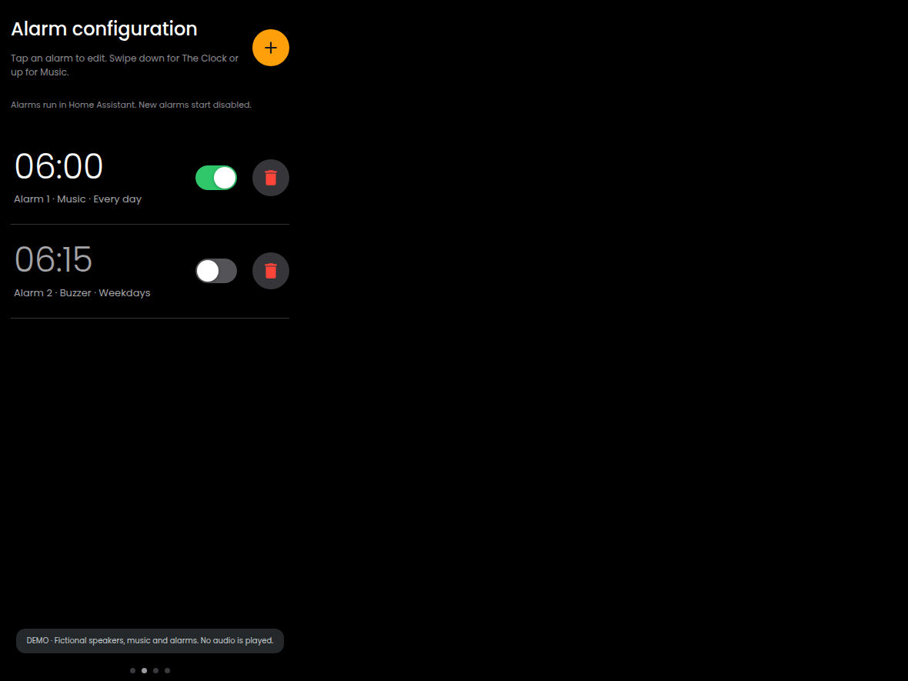
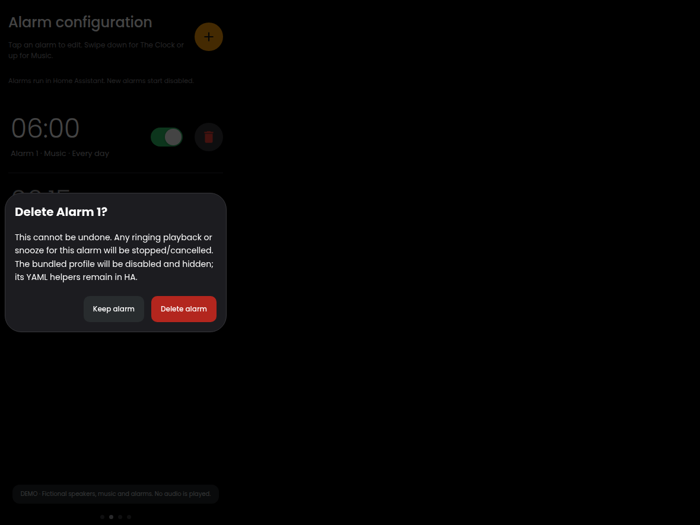
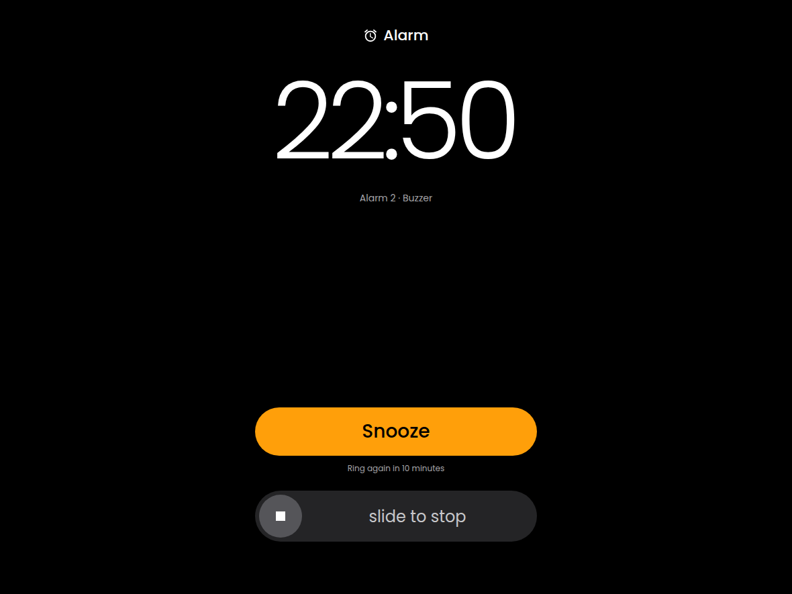
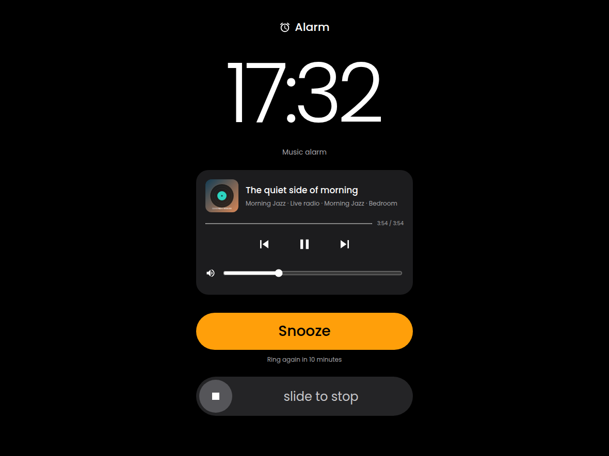
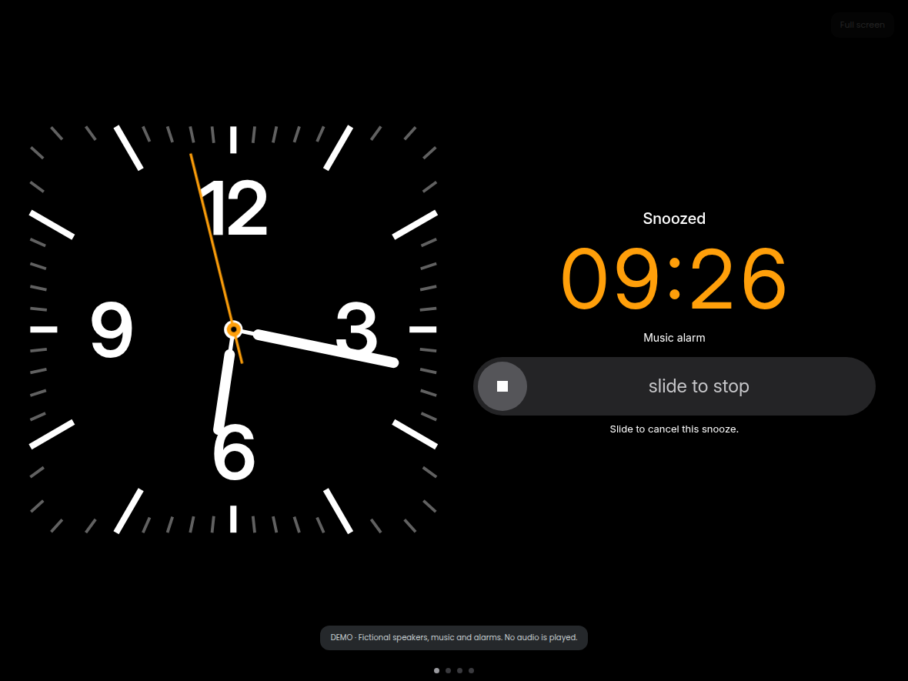
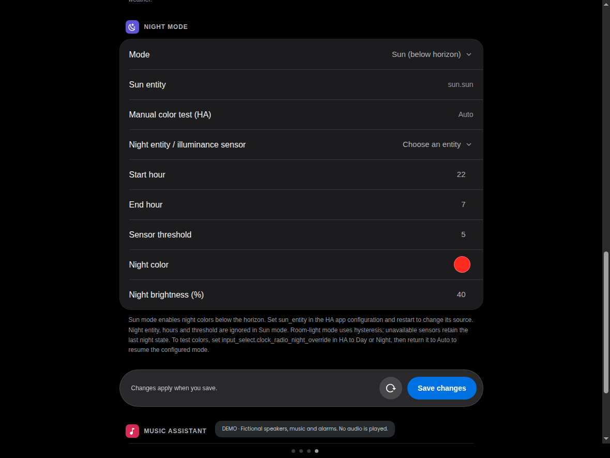

# Clock Radio configuration

## Four pages and alarm helpers

The HA alarm behavior below is the default. An opt-in
[Kiosk Satellite backend](#kiosk-satellite-alarm-backend)
keeps this app's editor while using native device scheduling instead.

All four main-page canvases and the app/loading background are pure black
(`#000000`). Cards, controls and dialogs keep contrasting surfaces; clock
colors can still be customized in Settings.

There is no menu. Swipe **left/right** between **The Clock**, **Alarm configuration**,
**Music overview** and **Settings**, or use keyboard **Left/Right arrows** or
**Page Up/Down** outside
form inputs. Vertical swipes scroll Alarm configuration, Music and Settings
without changing pages. Horizontal music carousels and tab strips scroll first;
start a new swipe at their edge, or swipe outside them, to change pages.
Music categories are selected by tapping their tabs, not by swiping.
Open player dialogs and sliders do not trigger page swipes.
After two minutes without touch, mouse, scrolling or keyboard activity, Alarm
configuration, Music and Settings automatically return to The Clock. Set
`return_to_clock_minutes` in **Settings > Apps > Clock Radio > Configuration**
to change the timeout (whole minutes, 0-1440; `0` disables it), then restart the
app. Activity and page changes restart the countdown. Open editors/dialogs,
ringing alarms, held touch/pointer gestures and pending saves pause it; a fresh
countdown starts when they finish. Returning to the clock does not stop music,
change HA alarms or discard unsaved inline Settings values. Background state
polling does not count as activity; an overdue idle page returns when a
backgrounded browser becomes active again.

While the configured Music speaker is playing, a mini-player replaces the Clock's
usual widget on the right (below the clock in portrait). Use it to pause playback,
adjust volume when supported, or tap the artwork or track info to open the full
player. The normal widget returns when playback pauses or stops. Ringing alarms
and the snooze countdown take priority over the mini-player.

Four dots at the bottom of every main page show your position, left to right:
Clock, Alarm configuration, Music, Settings. The active page has a grey dot;
the other dots are darker. They are position indicators, not buttons. Screen
readers announce the page name and position, such as "Page 4 of 4: Settings".
Swipe up/down within the split clock's left panel to cycle square analog,
round analog and digital faces; the right panel cycles calendar, weather, date
and date/calendar. These selections save to YAML. Full-screen faces and hiding
the widget remain Settings options. Swipes cannot save views in read-only mode.
Keyboard navigation mirrors these axes: **Left/Right** go to the previous/next
main page; **Up/Down** choose the previous/next view of the focused Clock panel.
Use **Tab** or click/tap the face/widget to select a panel; a keyboard focus
outline identifies it and focus is restored after saving a view. With focus on
the Clock page itself, Up/Down selects the last-focused panel (initially the face).
Up/Down elsewhere scrolls normally. Inputs, sliders, editable content and dialogs
keep their own keys; modifier shortcuts and held-key repeats do not navigate.
Full-screen and snoozed Clock panels cannot change views.

See the [four-page screenshot gallery](../README.md#screenshots) for the Clock,
Alarm configuration, Music overview and Settings. All screendumps below use
fictional demo data, not a real HA installation.

See the [Home Assistant alarm package](../examples/home-assistant/README.md) for
two independent Music/Buzzer alarm profiles and native entities cards. Install
that package separately in Home Assistant. Alarm configuration edits the existing
`clock_radio_alarm_N_*` helpers, including enabled state, type, wake time, seven
weekdays, volume (0-100%) and wake timer (1-120 minutes). Profiles may
use different times, durations and Music radio stations; all use the configured
app speaker. Missing/unavailable helpers are shown explicitly and cannot be saved.
Configure the shared default Music source and Buzzer source helpers in HA as
described in the alarm package setup; these shared defaults are not editable
in the app.

Alarm configuration shows a compact list with large wake times and immediate
enable switches. Alarms are identified by time, type and repeat days rather
than numbered names; internal HA profile/helper IDs are unchanged.
Setup/deletion warnings appear only when action is needed.
Tap an alarm to open its editor. Scroll the hour/minute wheels
or use Arrow Up/Down, Home/End and Page Up/Down while a wheel is focused.
The wheels follow the clock's 12/24-hour setting; 12-hour mode includes AM/PM.
The displayed HA time zone always determines the schedule, not the tablet's zone.
Choose circular repeat weekdays, or use **Every day** / **Weekdays** shortcuts.
An enabled alarm requires at least one selected day; no days does not mean
a one-shot alarm.



The editor groups the existing Enabled, Music/Buzzer, volume (0-100%) and wake
timer (1-120 minutes) controls. The wake timer stops playback and is **not Snooze**.
No label or per-profile snooze fields are added. **Save** applies changes and closes;
**Cancel** or **Escape** discards the draft without writing to HA. Drafts survive
polling; page swipes and keyboard page navigation are blocked while editing.
Direct navigation away from `#alarms` closes the editor without saving.
Save errors remain visible in the editor, with **Reload saved values** to inspect
HA's actual state. Missing, invalid or incomplete helpers cannot be edited or
enabled; additional incomplete profiles still offer **Finish setup**.

The editor shows the time wheels, repeat-day shortcuts and existing profile
controls. Scroll inside the editor if controls do not fit your screen.


### Music alarm radio station

When **Alarm type** is **Music**, a **Radio station** list appears directly below
it, showing Music Assistant radio names and logos. Click/tap a radio to select
it **for this alarm only**, then **Save alarm**. Selection does not start music.
The radio list comes through HA's Music Assistant integration; a separate MA
browsing URL/token is not required.


**Use shared HA default** clears this alarm's override and uses
`input_text.clock_radio_music_source`. Existing alarms keep this default until
you save a station. **Cancel** discards the station draft. Switching to Buzzer
hides the list without losing its selection; Buzzer uses its independently
selected sound or shared default.
The saved radio also applies when that Music alarm resumes from Snooze.
Draft station choices survive polling without moving keyboard focus.

Install/reload scheduler package **version 5**, including
`input_text.clock_radio_alarm_1_music_source` and
`input_text.clock_radio_alarm_2_music_source`. These restoring, maximum-255-character
helpers must not have `initial` values. Newly created profiles include their own
source helper; existing app-created profiles receive it through HA's admin-only
API when their first station choice is saved. Do not reset initialization flags.
Older packages can still edit existing alarm settings but cannot choose a station.

HA can create a native text helper with state `unknown`, not an empty string.
The app explicitly initializes new per-alarm sources to empty (shared default)
and verifies the result before finishing setup. **Finish setup** can initialize
an unknown source on a disabled, incomplete profile without resetting saved
station values or other existing helper edits.

If an already-complete profile created by an older app release has this problem,
first confirm that its Music Source helper is `unknown`, not `unavailable` and
not a saved station URI. In HA **Developer tools > Actions**, initialize only
that helper once, replacing `3` with the affected profile's helper ID:

```yaml
action: input_text.set_value
target:
  entity_id: input_text.clock_radio_alarm_3_music_source
data:
  value: ""
```

Then select a station and save in the alarm editor. Do not clear an existing
station URI or reset alarm initialization flags. An `unavailable` helper still
requires restoring its HA integration; the app does not silently reset it.

An empty or failed library shows an explicit message. Add radios to Music
Assistant's library; normal radio refresh is every five minutes (one minute after
an error). A previously saved station missing from the current library remains
selected and is not silently replaced. Choose a different station or the shared
default to change it; unrelated edits preserve it. Unavailable source helpers
must be restored in HA before choosing a station.

Saving a profile temporarily disables its schedule while the individual HA
helpers are updated, then applies the requested enabled state. If a write
fails, the app reports that the edit was incomplete; inspect the profile before
enabling it. Existing enabled states and helper values are not initialized or
reset just by opening the app. Native HA entities cards continue to work.
Configured-speaker changes temporarily pause enabled schedules and restore them
only after the speaker helper is saved. Conflicting edits are rejected;
failed edits immediately refresh the actual HA values rather than reporting success.

**Add alarm** with the current package creates 14 settings helpers (including
the per-profile Music source), a persistent initialization flag and a
restoring timer using HA's admin-only helper APIs. Fresh profiles default to
Music, 06:00, Monday-Friday, 50% and five minutes, **disabled**. Find this action
and profile controls on **Alarm configuration**. **Settings** contains
clock appearance and Music Assistant guidance. Direct links `#alarms` and
`#settings` open the respective pages; unsaved clock-form edits survive page changes.
Add alarm creates the disabled HA profile immediately and opens its editor.
Cancel leaves that new profile in HA, disabled, without applying draft edits.
The dynamic HA
package must expose `sensor.clock_radio_alarm_scheduler_version` >= 2 and have
available playback/stop scripts before creation is offered. The radio picker
additionally requires version 5 and its new bundled source helpers; saved values
and existing helper definitions are preserved.
Partial setup is explicitly reported and can be resumed with **Finish setup**;
existing helper edits are not overwritten. Review resumed values before enabling.
An incomplete profile is never scheduled. Helpers, times and timers remain in
HA after app restarts and work with the tablet/app closed.

### Buzzer alarm sounds

Set **Alarm type > Buzzer**, choose **Sound**, then **Save alarm**. Each alarm
has its own choice. **Use shared HA default** keeps using
`input_text.clock_radio_buzzer_source`; existing alarms retain that default.
Changing only the time, enabled switch or other settings preserves the sound.
Sound drafts survive polling; Cancel discards them.

The twelve original sounds are **Morning Light, Glass Drops, Warm Keys,
Woodland Tap, Orbit Pulse, Calm Steps, Bright Start, Round Bell, Soft Signal,
Silver Beat, Slow Sunrise** and **Daybreak Beep**. They are synthesized from
original patterns, licensed under this repository's MIT license, and are not
Apple recordings or copies of Apple melodies. Regenerate the WAVs with
`node dev/generate-sounds.js` from `clock-radio/app`.

**Preview sound** plays once on the tablet/browser, not the HA speaker. It
stops when you change sounds, leave the editor, switch to Music or save.
Selecting or saving a sound never starts alarm playback.

Setup for app 0.16.0 and scheduler package **version 7**:

1. Update/restart the Clock Radio app. Its new HA configuration mount publishes
   the bundled WAVs to HA's `www/clock-radio/sounds/v1/`. Only those versioned
   files are installed; unrelated files and modified originals are not replaced.
   Read-only mode does not publish files.
2. Replace the [HA alarm package](../examples/home-assistant/clock_radio_alarms.yaml),
   check configuration, and reload **scripts and templates**. No new YAML
   helpers, initialization reset or alarm rescheduling is required for 6 to 7.
3. Configure HA's **Settings > System > Network > Home Assistant URL** with an
   internal HTTP(S) URL reachable from Music Assistant and your speaker. If only
   an external URL is configured, it is used instead. Credentials, query strings
   and fragments are not accepted. The app checks that the public WAV is
   reachable before changing any alarm helpers.
4. If HA's `www` directory did not exist before installation, restart HA once
   so its `/local/` route is available. The WAVs are public static files; no HA
   token is embedded in their URLs or sent when checking/playing them.

On the first saved sound choice, the app creates a restoring, admin-only native
text helper `input_text.clock_radio_alarm_N_buzzer_source` and explicitly writes
the chosen absolute audio URL (or empty for shared default). Do not duplicate it
in YAML, give it an `initial` value, or reset an existing sound. Unavailable or
unknown existing helpers show an error rather than silently changing the sound.
Saving verifies HA accepted the source. Failed writes leave the schedule
disabled and the error visible; inspect the saved values before enabling again.
Deleting a native alarm also removes its sound helper.

HA plays and repeats the selected WAV until Stop or the wake timer expires,
including after Snooze. Playback works with the tablet and app closed. Version
6 retains existing shared Buzzer playback and reliable Snooze but cannot offer
per-alarm sound selection.

Standalone deployments must copy `app/web/sounds/v1/` into HA's
`www/clock-radio/sounds/v1/`, or set `HA_CONFIG_DIR` to the mounted HA configuration
directory before starting the server. HA's internal/external URL is still
required; the app's ingress URL and Supervisor proxy URL are not media URLs.

## Deleting alarms

Use the red trash button on an alarm row or **Delete alarm** in its editor.
The confirmation defaults to **Keep alarm**. Keep alarm or Escape cancels
without changing HA or losing an editor draft. Incomplete profiles can also
be deleted. Read-only, disconnected and conflicting busy controls are disabled.



Deletion stops/cancels only that profile's ringing playback, wake timer or
pending Snooze; it does not stop ordinary music or another profile's alarm.
For **app-created profiles**, HA's admin-only native helper APIs remove the
profile's settings, initialization flag and timer. For **bundled Alarm 1/2**,
their YAML definitions cannot be removed through runtime helper APIs: deletion
persistently disables and hides them instead. Their YAML helpers remain in HA,
but scheduled/manual starts and Snooze resumption are blocked.

Install/reload the current [HA package](../examples/home-assistant/README.md),
including scheduler version **7**, its deletion helpers and preparation script.
Existing saved settings and initialization flags must not be reset.
Packages without the deletion helpers retain their existing controls but cannot Delete.

If a deletion fails, its profile remains visible and disabled with a pending
deletion message. Check the reported HA permissions/helper or speaker error
and **retry Delete**. Do not use Finish setup to resurrect a partial deletion.
Complete the pending deletion before adding or deleting another profile.
The HA deletion marker restores across restarts so a partially removed profile
cannot begin playing before recovery.

## Ringing alarms and Snooze

A dedicated screen automatically takes over when an HA alarm rings, including
when opening the app during an alarm. Buzzer alarms show a large clock and
orange **Snooze** button. Music alarms also show a compact artwork/metadata
player with supported play/pause, previous/next and volume controls. The time
uses the clock's locale, time zone and 12/24-hour setting.
Ordinary music playback never opens this screen.

| Buzzer alarm | Music alarm with mini player |
| --- | --- |
|  |  |

Drag the **slide to stop** knob at least 90% across and release to stop the
alarm. Partial/cancelled gestures reset; tapping the track does not stop it.
Keyboard users can press End (or Arrow Right repeatedly), then Enter/Space.
Stop uses the HA alarm script, cancelling timers and restoring volume/repeat,
not merely pausing the speaker. The screen stays until HA confirms the alarm
ended; failures are shown on-screen. Read-only/disconnected controls are disabled.
Page navigation and Escape cannot dismiss a ringing alarm. When it ends, the
previous page returns; an interrupted alarm-editor draft is discarded.

**Snooze** silences either alarm type and rings again in **10 minutes**, even
with the app/tablet closed. A pending snooze appears in Alarm configuration
with **Cancel snoozed alarm** and contributes to the clock's next-alarm display.
On **The Clock**, the right-hand panel becomes a live `MM:SS` snooze countdown
with the captured alarm type and the ringing screen's **slide to stop** control.
In portrait it appears below the clock. Full-screen and widget-free layouts
temporarily use two panels; your saved layout, face and widget are restored
when HA clears snooze. Vertical panel swipes are paused during snooze.



The countdown uses HA's saved deadline, including after reload or returning from
a hidden page. Stopping waits for HA confirmation; failures remain visible and
can be retried. Read-only/disconnected controls are disabled. At `00:00`, the
panel waits for HA to resume the alarm rather than starting audio locally or
pretending snooze has ended. A stale cancellation cannot dismiss a replacement
alarm: the stop request must match the current snoozed ID, type and deadline.

A new alarm replaces a pending snooze. Resuming uses the captured Music/Buzzer
type with the profile's current duration/volume, shared speaker and current
per-alarm source (or shared source when no override is saved).
No schedule is enabled or disabled by snoozing.

For reliable captured ringing state and Snooze, replace the installed HA package
with the current version (scheduler version **7**), including the new text and
date/time helpers. Check configuration and reload helpers, scripts, templates
and automations; restart HA if `input_datetime` was not previously loaded.
Do not rerun/reset initialization flags. Older packages still support the
ringing screen when exactly one alarm timer and an active speaker identify it,
but Snooze now requires scheduler version **6** and is disabled with an upgrade
message on older packages. Version 6 fixes fractional-second deadlines that
could cause the one-shot time trigger to run before the due check accepted it.
New deadlines use whole seconds, and a minute-based recovery trigger catches
missed due snoozes. Existing version 5 installations need scripts, automations
and templates reloaded after replacing the package; no helper values or
initialization flags should be reset. Cancel an overdue snooze first if you
do not want the recovery trigger to ring it during the update.
The Snooze deadline survives HA restarts: future snoozes remain pending, and
an overdue snooze rings once when HA starts again. Ordinary alarms missed while
HA was down are not replayed.

## First start

The app copies its example to `/config/dashboard.yaml` inside the container.
This is the app-specific configuration directory, **not** Home Assistant Core's
`configuration.yaml` directory. On current Supervisor installations, it is
available to appropriately configured editors/Samba under
`/addon_configs/<repository-id>_clock_radio/`. Open the Clock Radio app's folder
and edit `dashboard.yaml`. You do not need to modify HA YAML.

Changes are applied within five seconds without restarting. Invalid YAML or
settings are reported in the app log and dashboard; the last valid version
stays active. Invalid configuration on startup prevents the app from starting.
Existing files are never replaced by the example, including during app upgrades.
The Settings clock form atomically writes only the `clock` section, preserving
the remaining settings and YAML comments. It refuses to overwrite invalid YAML.

## Dashboard settings

```yaml
title: Bedroom Radio
locale: en-GB
time_zone: Europe/Copenhagen
clock_24h: true
show_seconds: false
stations:
  - id: favourite
    name: My favourite station
    media_content_id: "https://your-station.example/live.mp3"
    media_content_type: music
    source: home_assistant
```

Replace the example stream URL with a real, authorized station stream. A web
page containing a player is not usually a stream URL. Your selected speaker
must be able to reach and decode the URL. The app itself does not fetch streams.

| Setting | Default | Meaning |
| --- | --- | --- |
| `title` | `Clock Radio` | Dashboard heading and browser title. |
| `locale` | `en-GB` | Music labels (English/Danish) and legacy clock locale. |
| `time_zone` | `""` | IANA time zone, e.g. `Europe/Copenhagen`; empty follows HA. Alarm schedules always use HA's zone. |
| `clock_24h` | `true` | Legacy time-format default when `clock.time_format` is absent. |
| `show_seconds` | `true` | Legacy seconds default when `clock.seconds` is absent. |
| `players` | `[]` | Legacy field; superseded by the app's `media_player` option. |
| `default_player` | `""` | Legacy field; does not override the configured app speaker. |
| `stations` | `[]` | Presets with unique lowercase `id`, `name`, and `media_content_id`; shown alongside MA library radio. |
| `clock` | See below | Clock appearance and live-data sources; saved by Settings. |

### Clock views and options

The renderer is adapted from [nightstand-clock](https://github.com/taclab/nightstand-clock).
The widget layout offers square analog, round analog and digital faces with
calendar, weather, date, date/calendar or no widget. Portrait stacks the panels.
Full-screen analog extends its dial to the screen edges; full-screen digital
uses oversized digits with date/weather and the next alarm.

| `clock` key | Values / default |
| --- | --- |
| `layout` | `widget` (default), `full` |
| `face` | `analog` (default), `analog-round`, `digital` |
| `full_face` | `analog` (default), `digital` |
| `widget` | `calendar` (default), `weather`, `date`, `date-calendar`, `none` |
| `seconds` | Boolean; default `true` |
| `second_hand` | `"60"`, `"30"` (default), `tick` |
| `time_format` | `automatic`, `24-hour` (fallback default), `12-hour`; first-run example uses automatic |
| `language` | Empty: device locale; `en`, `fr`, `de`, `es`, `it`, `pt`, `nl` or a valid locale. Existing `locale` is inherited when this key is absent. |
| `week_start` | `automatic` (default), `monday`, `sunday`, `saturday` |
| `primary`, `accent`, `seconds_color`, `background` | Six-digit hex colors; defaults `#ffffff`, `#ff3b30`, `#ff9f0a`, `#000000` |
| `weather_name` | Optional place label; empty uses the HA entity's friendly name |
| `weather_entity` | Legacy key accepted for compatibility but ignored; use the HA app option |
| `next_alarm_entity` | Optional timestamp sensor or `input_datetime`; time-only helpers are daily. Empty derives the next enabled Clock Radio alarm. |
| `night_mode` | `off` (default), `always`, `schedule`, `sun`, `entity`, `illuminance` |
| `night_start`, `night_end` | Hours 0-23; defaults 22 and 7; overnight schedules supported |
| `night_entity`, `night_threshold` | HA night entity / room illuminance sensor and threshold; defaults empty and 5 |
| `night_color`, `night_brightness` | Night color and brightness 20-100%; defaults `#ff2a1f` and 70 |

Settings uses an iOS-inspired black appearance with rounded grouped lists,
trailing control values, color swatches and a seconds switch. All existing
options remain available. **Save changes** applies the clock form; the circular
reload button (**Reload values**) discards the draft and restores saved values.
The floating action bar stays above connection/error notices. Drafts and focused
controls survive background refreshes, and read-only/disconnected mode disables
changes. Use the **Alarms** and **The Clock** links at the top or the existing
swipe/keyboard navigation to change pages.

Choose **Settings > Night mode > Mode > Sun (below horizon)** to
follow the Sun entity set by `sun_entity` in **Settings > Apps > Clock Radio >
Configuration** (default `sun.sun`; empty also uses this default). Save and
restart the app after changing it. `below_horizon` enables
your night color/brightness; `above_horizon` restores the daytime colors.
Enable the HA Sun integration and configure HA's location correctly.
No automation, schedule hours, threshold or dashboard night-entity selection is required.
Existing night-entity/hour/threshold settings are preserved but ignored in Sun
mode. Horizon changes are applied on the next refresh (within five seconds).
If the sun entity is missing, unavailable or invalid, a visible warning appears
and the last known night state is retained (daytime on first start).
Sun mode is opt-in; existing night modes and settings are unchanged.

The Settings page can be scrolled to the Night mode group. The configured
**Sun entity** is shown as a read-only row. In Sun mode, the separate night-entity
selector, hours and sensor threshold shown below are not used.

### Manual clock color test

Clock Radio 0.13.0+ optionally follows
`input_select.clock_radio_night_override`, with the exact choices **Auto**,
**Day**, **Night**. This overrides only clock colors, not alarms or music.
The configured Night mode and its settings are never rewritten:

- **Auto** follows your configured Sun, schedule, entity, illuminance, always
  or off mode.
- **Day** forces your daytime primary/accent/seconds/background colors.
- **Night** forces the configured night color and brightness over black.

Create a **Dropdown** helper under **HA Settings > Devices & services > Helpers**
named **Clock Radio night override**, with those three options in that order.
Check that its entity ID is exactly `input_select.clock_radio_night_override`.
Alternatively, install the standalone
[night-mode helper package](../examples/home-assistant/clock_radio_night_mode.yaml)
using HA's packages mechanism, check configuration and reload input selects.
Restart HA if input selects have not been loaded before. Use only one definition;
do not install the package if you already created the helper another way.
No alarm package, Music Assistant integration or app configuration option is
needed for this helper.

Select **Day** or **Night** in HA to test the colors, then return to **Auto**.
Changes are picked up during normal five-second polling, including when the
dashboard is read-only.
**Settings > Night mode > Manual color test (HA)** shows the helper's current
selection; the row is informational, not another clock-form setting.
Selections restore across HA/app restarts, so remember to return to Auto after
testing. Auto is the default when the helper is first created.

Without the optional helper, existing behavior is unchanged. If an installed
helper becomes missing, unavailable or invalid, a visible warning appears and
the last valid override is retained (Auto if none has been read yet). Valid
values clear the warning. If you intentionally remove the helper, restart the
app to return to ordinary helper-free operation.



Set `weather_entity` in **Settings > Apps > Clock Radio > Configuration**, save
and restart the app. This is the only weather entity selector; the dashboard
Settings page edits the optional place label, not the weather source.
When upgrading from 0.4.0 or earlier, copy any existing `clock.weather_entity`
from `dashboard.yaml` into the HA app option. Legacy YAML still loads but cannot
enable or override weather. An empty app option disables weather.

Weather uses current HA conditions and today's daily high/low from the legacy
forecast attribute or `weather.get_forecasts`, refreshed every 30 minutes
(five minutes after an error or while today's forecast is missing).
Yesterday's high/low are never shown as today's.
Full-screen faces show a next alarm only when it is within 24 hours; scheduled
profiles are calculated in HA's timezone, including weekday and DST changes.

Room-light mode uses a selected **HA illuminance sensor**, not Android/Kiosk
hardware access. Night starts at/below its threshold and ends above threshold
+25%; numeric entity mode uses threshold +10% (at least 1) for hysteresis.
Boolean-like entities are night while `on`, `true` or `below_horizon`.
Unavailable entities retain their last night state and show a warning.
Night uses a black background and the selected color/brightness; it does not
change hardware brightness, stop device sleep, or enable a screen wake lock.

Presets accept HTTP(S) streams or `media-source://` identifiers supported by
Home Assistant's `media_player.play_media`. `media_content_type` defaults to
`music`; use the value required by your integration. URLs containing embedded
usernames/passwords are rejected. Keep all credentials out of configuration.

### Music Assistant

Install the Music Assistant integration in HA and expose the desired speaker
as a `media_player`. For a station from Music Assistant's library:

```yaml
stations:
  - id: ma-radio
    name: My Music Assistant station
    source: music_assistant
    media_content_id: "library://radio/123"
```

Replace `123` with your library radio item's actual ID. This calls the
`music_assistant.play_media` action with `media_type: radio` and
`enqueue: replace`, targeting the selected HA player. `radiobrowser://` radio
URIs and HTTP(S) streams are also accepted in this mode. Only Music Assistant
players can handle these actions. MA library radio is also read through HA
automatically, without a separate MA token.

Radio logos use the ready-made image URLs supplied by HA, without requiring MA
browsing configuration. A playing radio's exact library URI selects its station
logo for now playing and the ringing Music mini player, avoiding stale or failing
HA player-image proxies. Logos remain cached and proxied server-side; ordinary
music keeps its existing artwork source.

Discover, Albums, Artists, Podcasts, Playlists and Search use Music
Assistant's own API. Set `music_assistant_token` to a **read-only** token from
MA **Settings > Profile**. A running HA Music Assistant app is discovered via
Supervisor when no `music_assistant_url` is set; otherwise supply its HTTP(S)
address (normally port 8095). Restart after changing connection options.
Unconfigured browsing and unavailable services are shown explicitly.

The music page retains Dasher's layout and tap-selectable tabs,
recommendations, sorting/favorites/filtering, item detail/track lists, queue
actions, search and the full-screen artwork player. Speaker selection, grouping
and Party are removed.
Seeking/previous/next/shuffle/repeat/volume depend on player capabilities.
The artwork player opens on request, never automatically over the clock.
The HA app's configured media player is the only playback/volume target.
Old per-device speaker preferences cannot override it.

Tap the now-playing artwork or title to open this full-screen player. It is
separate from the automatic ringing-alarm screen.


## App options

Set these in **Settings > Apps > Clock Radio > Configuration** and restart:

- `log_level`: `debug`, `info` (default), `warning` or `error`.
- `return_to_clock_minutes`: minutes of inactivity before Alarm configuration,
  Music or Settings returns to The Clock. Defaults to `2`; whole numbers from
  `0` to `1440` are accepted, with `0` disabling automatic return. Dialogs and
  pending saves pause the timeout; music and unsaved Settings drafts remain.
- `media_player`: one HA entity ID, for example `media_player.sovevaerelse`.
  Required for HA playback. Used by Music and HA-backed alarms; the app updates
  `input_text.clock_radio_player` without changing alarm times or enable choices.
  An unavailable configured player never falls back to another speaker.
  In read-only mode the helper is not changed and a mismatch is reported.
  Kiosk mode never updates that HA helper.
- `alarm_backend`: `home_assistant` (default) or `kiosk_satellite`.
  Restart after changing. Backend changes do not migrate, disable or delete
  schedules on either system; remove Clock Radio's native alarms explicitly.
- `kiosk_satellite_url`: Kiosk's LAN Remote Administration HTTP(S) origin,
  without a path, credentials, query or fragment. Used for native alarms or
  Settings > Kiosk Satellite updates or Proximity screen dimming, with
  either alarm backend.
- `kiosk_satellite_token`: Kiosk Remote API bearer token, masked in app options
  and retained only on the server. Not an HA/MA token. Required for native
  alarms, KS updates and proximity dimming; restart after changing the
  address/token.
- `kiosk_satellite_alarm_ui`: `native` (default) or `clock`. Clock presentation
  requires compatible KS dashboard-alarm support and its trusted dashboard URL;
  unsupported devices keep native controls. Native scheduling remains unchanged.
- `weather_entity`: optional HA weather entity ID, for example
  `weather.forecast_home`. The sole weather source for widgets and full-screen
  clocks. Empty disables weather; missing/unavailable entities show an error
  and never fall back to another source.
- `sun_entity`: HA Sun entity ID used by **Sun (below horizon)** night mode,
  for example `sun.sun` or a renamed `sun.bedroom`. Missing/empty uses `sun.sun`.
  This is configured only in the HA app options, not the dashboard night-entity
  selector or YAML. An unavailable configured entity shows its ID in a warning
  and retains the last night state; it never falls back to another Sun entity.
- `read_only`: defaults to `false`; when enabled, the server refuses every
  playback, alarm creation/editing and clock-settings mutation, even direct API requests.
- `music_assistant_url`: optional HTTP(S) base address without credentials,
  query or fragment; empty enables Supervisor discovery.
- `music_assistant_token`: optional MA read-only access token. Stored only in
  Supervisor app options/environment, never dashboard YAML or browser state.

## Proximity screen dimming

In **Settings > Proximity screen dimming**, enable the option and
**Save changes**. It targets the KS device configured by
`kiosk_satellite_url`/`kiosk_satellite_token`, with either alarm backend.
It uses KS's built-in proximity sensor and actual hardware brightness,
not CSS darkening or a browser timer.

Saving enabled configures KS's native **Dim** screensaver: idle timeout
**600 seconds**, dim level **10%**, proximity postponement and proximity
wake. Clock Radio stays visible. A held proximity signal postpones dimming;
an approach after dimming dismisses it and KS restores its saved brightness
level. Touch and other native activity also reset the native idle timer.
Normal brightness, adaptive-brightness settings and alarm schedules are
not changed. Adaptive brightness still applies to the 10% ceiling, so the
actual panel may be dimmer according to room light.

This replaces KS's current screensaver mode with Dim and disables its
automatic screensaver screen-off. It does not turn the screen off or
change the Clock's Sun/night colors. Disabling the option turns an existing
native Dim screensaver off, allowing KS to restore brightness; other
screensaver modes are not disabled by an unchecked option.

KS must report compatible settings and a supported proximity sensor.
Some call-only palm sensors cannot detect someone approaching the device.
Enabled KS screensaver schedules or lockdown block configuration because
they can override the mode/brightness or prevent proximity wake. Adjust
those in KS first. Configuration is also blocked during a native alarm,
sunrise or snooze, and in read-only/offline mode.

Saved behavior continues natively with HA offline or the Clock page
reloaded. The settings display refreshes at most once per minute in the
background; **Reload values** reads fresh native settings. Changes are
verified before reporting saved. If a native request fails or is only
partially accepted, inspect KS and reload before retrying; requests are
not automatically retried. Credentials and native dimming metadata are
never stored in the browser's offline snapshot.

## Updating Kiosk Satellite

**Settings > Kiosk Satellite updates** can check for a newer release and
start installation on the KS device configured by `kiosk_satellite_url` and
`kiosk_satellite_token`. This works with **either alarm backend**, including
HA scheduling, and does not require HA to be online. Missing or invalid KS
configuration is explained in Settings; it does not change HA alarm behavior.

The version/status display polls KS's native update state, not GitHub.
**Check for updates** asks KS to check its configured source immediately.
**Install KS update** opens a confirmation naming the current offer and the
configured device. A changed offer/device requires fresh confirmation. The
server rechecks native alarm and update state before dispatching the install;
active native alarms, sunrise, snooze and an existing download/install block it.
Avoid updating shortly before a scheduled alarm: an update can restart KS
or interrupt playback, and schedules can become due during a download.

KS chooses the update package for its platform/architecture, uses its existing GitHub/custom
repository setting, verifies and installs it through its normal installer.
Clock Radio never accepts an APK URL/upload or updates a fleet. Some devices
need Android confirmation on the KS screen, and devices without automatic
relaunch may need KS reopened manually. A release published after confirmation
can be selected by KS's own latest-release recheck.

Download progress, installer handoff and failures remain visible in Settings.
An accepted request is **not** reported as a completed installation: Clock
Radio waits for KS to report a newer installed version. Requests are never
automatically retried. After a failed/uncertain request, or cancelling a native
Android prompt, inspect KS and use **Check for updates** before manually
confirming another attempt. Lost connections and read-only/offline snapshots
disable installation. Checking metadata remains available in read-only mode.
The admin credential, APK paths and raw native error details never enter the
browser or its offline snapshot.

<a id="experimental-kiosk-satellite-alarm-backend"></a>

## Kiosk Satellite alarm backend

This backend keeps **The Clock** and the existing alarm list/editor but saves
native alarms on one configured Kiosk Satellite device. It is not a plugin.
**Home Assistant remains the default backend.** Verify triggering, playback
and native Stop/Snooze on your installed Kiosk/Android version before relying
on important alarms.

### Configure and connect

1. Enable Kiosk **Remote Administration**, set its password, and confirm the
   installed version offers native alarms and the `alarmsStatus`, `alarmSave`
   and `alarmDelete` commands.
2. Obtain a Remote API token with Kiosk's `POST /api/login` endpoint. Its JSON
   body takes `password` and optionally `ttl_days`; tokens expire after seven
   days by default and must be renewed. See the [official Remote API authentication guide](https://github.com/jxlarrea/kiosk-satellite/blob/main/docs/remote-api.md#authentication).
3. In **Settings > Apps > Clock Radio > Configuration**, set:

   ```yaml
   alarm_backend: kiosk_satellite
   kiosk_satellite_url: "http://<echo-ip>:2324"
   kiosk_satellite_token: "<remote-api-token>"
   ```

4. Save and restart Clock Radio. Open **Alarm configuration** to verify that
   the native alarm list loads.
   Authentication, connection and malformed-response errors are explicit;
   failed native requests never fall back to creating HA alarms.

Use the Echo's LAN address, **not** `127.0.0.1:2325`: the secure-context proxy is
local to the Echo, while this connection originates on the app server. HTTPS
certificates must be trusted by the server; certificate checks are not disabled.
The Remote API token is a powerful admin credential. Keep it private and use
a trusted LAN or HTTPS. Browser API responses, logs and local snapshots do not
include it. All tablets connected to this app manage the **same configured kiosk**.

### Supported behavior and differences

- **Add alarm** creates a confirmed, disabled `Clock Radio [TEST]` draft; the
  existing native label is unchanged. Cancel leaves it disabled. Only alarms with generated
  `clock-radio-<32 hex digits>` IDs appear or can be changed. Other native
  alarms and all HA schedules are neither imported nor modified.
- Time wheels, repeat days, Music/Buzzer and enable switches stay in our UI.
  Schedules use the **Kiosk device's local time zone**, not HA's time zone.
  No repeat days means **once**, unlike the default HA backend.
- **Clock Radio remains the alarm configuration UI for both backends.**
  Choose **Buzzer** and its **native tone** here: Kiosk's built-in alarm,
  a sound already in the device's sounds folder, or **Use Kiosk tone default**.
  New drafts use the built-in tone. The twelve HA-hosted WAV choices are not
  copied to the device. Native tone selection does not play a preview.
- For **Music**, choose a category (including radios) and select the item
  in **Clock Radio's editor**. New selections use **Music Assistant** and
  its speaker named exactly **show-01**; the source/speaker selectors and
  **Use Kiosk music default** button are no longer shown.
  **Open** browses folders/albums/playlists; **More music** fetches another
  page. Saving stores this alarm's source, speaker and music on Kiosk.
  Catalogs load on demand, not on every state poll. Music Assistant must
  already be configured on Kiosk and show-01 must be available. A missing,
  duplicate or unavailable speaker shows an error, never another speaker's
  choices. This does not change KS's global source or followed speaker.
- The **Selected** summary shows what Save will use. New music choices save
  Music Assistant/show-01 with the selected item. Browsing does not change
  saved music; saving choices does not start playback.
- Existing alarms that inherit **Kiosk Settings > Alarms > Alarm music**
  keep that inheritance. Switching Buzzer to Music initially follows it unless
  you select an item. Buzzer explicitly opts out of music. Kiosk uses the
  selected fallback tone if music cannot play or no default is configured.
  Music still needs its source/network; the native tone does not.
- **Upgrading:** no alarms are rewritten. Unlike 0.19.1, saving schedules or
  toggling an alarm now preserves its existing music override and native tone.
  Re-select music to change its source/speaker to Music Assistant/show-01. A catalog
  failure does not prevent time/day edits with the existing choices unchanged.
  The HA `media_player` option and separate HA Music page do not control
  native alarms. Standalone direct-URL native alarm music requires a Kiosk
  enhancement and is not exposed as a working option.
- **Volume, Snooze length and Silence after are device-wide Kiosk settings**,
  not per-alarm fields. Their HA-specific controls are hidden, not silently
  ignored or mapped to fabricated values.
- **Ringing, Stop and Snooze use Kiosk's native screen by default**, which may
  cover our dashboard. Compatible devices can opt into the Clock Radio UI
  described below. Its native Remote API stops/snoozes all simultaneous alarms,
  so Clock Radio never exposes those unscoped operations.
- Stop a native alarm before editing it. **Disable it before deleting it.**
  These checks protect active alarms and unrelated native playback.
- Saving/deleting requires Kiosk, not HA, to be reachable. Clock settings
  and HA music controls retain their existing HA connection policy.
  Read-only app mode still blocks all native writes.

### Clock Radio ringing UI for KS

This is capability-gated support for the coordinated upstream KS
dashboard-alarm enhancement, **not a workaround for existing KS versions**.
The installed KS build must advertise presentation protocol 1 in
`alarmsStatus` and expose `kioskSatellite.alarmUi` to its main WebView.

1. On a compatible KS build, set **Settings > Alarms > Dashboard alarm UI URL**
   to the exact Clock Radio URL loaded on that device, without query or
   fragment. With the secure-context proxy this can be
   `http://127.0.0.1:2325/`; it is not the server's original LAN URL.
2. In the HA app configuration, set `kiosk_satellite_alarm_ui: clock`, save
   and restart Clock Radio. Keep the usual KS Remote Administration URL/token
   on the server for schedule editing.
3. Fully reload the KS dashboard. The banner explains missing native
   capabilities, the trusted-URL setting or a mismatched device.

On the configured KS device, Clock Radio shows its existing ringing screen
with native station/speaker names, native Snooze length and Slide to Stop.
Snooze returns to the Clock's countdown widget, with Slide to Stop cancellation.
Native music's playback/volume controls remain on KS; the HA media-player
controls are not misapplied to its renderer.

After rendering usable controls, the **device-local** bridge acknowledges the
exact current native occurrence and alarm group. A once-per-second heartbeat
renews presentation; KS restores its native ringing screen after a four-second
lapse. Navigation, a failed/unrenderable page, hidden tab, lost app/KS
connection or read-only mode gives control back. A remote browser or server
cannot impersonate the device's UI. The opaque runtime device identity also
prevents a dashboard on another KS device from claiming this backend.

KS still owns alarm triggering, audio, volume ramp, music failure tone,
auto-silence and snooze re-ringing. Sunrise stays native. The dashboard neither
starts audio nor schedules browser timers. Stop/Snooze carry the exact native
context and cannot act on a stale occurrence or partial simultaneous group.
Only wholly Clock Radio-managed groups are shown; unrelated or mixed groups
retain the KS screen. Actions that time out are never automatically retried.
Existing KS builds and the default `native` option behave as before.

The app server makes bounded, authenticated native calls without retries and
reads schedules back before reporting success. A timed-out save may have
completed: refresh and inspect the native list before retrying. Native changes
are never queued offline. Cached definitions retain their backend/device
identity, are read-only and cannot recreate live ringing/Snooze state.

### Verify your device and switch back safely

1. Choose a test time that does not duplicate an enabled HA or personal native
   alarm. This option intentionally leaves existing HA schedules running.
2. In Kiosk **Settings > Alarms > Alarm music**, choose a radio and speaker and
   verify **Preview** works. Create and enable a short-term Buzzer test in
   Clock Radio; repeat with Music. Reload the dashboard after an app update
   so it uses the current editor.
3. Verify on the Echo with the dashboard closed, HA stopped and Wi-Fi off,
   including native tone fallback and native Stop/Snooze. Separately test
   screen-off behavior and a device restart. Mock tests do not prove that the
   Echo can wake or make sound; device power and OS permissions still matter.
4. Before switching back, stop, disable and delete Clock Radio's native alarms
   while the Kiosk backend is selected. Then switch `alarm_backend` to
   `home_assistant` and restart.
5. If already switched back, delete Clock Radio's alarms in Kiosk's native
   alarm list or Remote Administration.

**Changing the option, stopping Clock Radio or losing HA does not cancel saved
native alarms.** Editing still needs the Clock Radio server; this feature does
not add offline app-shell loading or direct browser-to-Kiosk control.

## Clock and controls

The clock uses the tablet's system time, formatted in the configured/HA time zone.
Keep the tablet's automatic date/time enabled. Player state is refreshed every
five seconds; commands trigger an immediate refresh. Pause, resume, stop, volume
and station buttons depend on the capabilities reported by the selected player.

No speakers and no stations have explicit setup messages. Disconnected HA
shows a warning and disables commands; the clock continues. Missing configured
players are listed on the dashboard.

## Offline snapshots and request deadlines

After a successful alarm-backend synchronization, this browser saves clock appearance,
time zone and alarm definitions in local storage. On reload it restores that
snapshot immediately as **read-only**, until a fresh response confirms the
connection. Failed requests and empty/disconnected responses never overwrite
the last good snapshot. Reconnection replaces saved definitions with the selected backend's
current state, including deleted alarms; it never merges or replays changes.

With the default HA backend, the offline banner includes the last synchronization date/time and explains
that HA alarm execution cannot be confirmed. Schedules remain inspectable,
but alarm switches, editing/saving, speaker controls, Stop and Snooze are
disabled. Cached data does not recreate ringing screens, Snooze countdowns,
next-alarm timestamps, weather readings or playback state. An already-open
ringing screen stays visible during a disconnect, with its controls disabled.
Sensor-driven night colors retain their last confirmed state while offline;
clock time and scheduled night colors continue using the device's clock.

With the Kiosk backend, native alarm controls remain available during
an HA outage if the app server and Kiosk are reachable. If Kiosk disconnects,
its cached definitions become read-only; HA music/clock controls still use
HA's connection status. Native snapshots are scoped to the configured backend
and kiosk origin and never restore live native ringing/Snooze state.

Snapshots contain no credentials, artwork tokens or alarm/radio source URLs.
They belong to this browser profile and origin (address/port), not to HA
backups or other tablets. Clear the site's browser data to remove them; use a
trusted browser profile because same-origin pages can read local storage.
Storage failures or corrupt/unsupported snapshots show a visible warning
and a console warning; the running page can still retain a valid in-memory
snapshot. Unchanged definitions checkpoint the timestamp at most once per
minute; definition changes are saved immediately after a confirmed state read.

State requests time out after **8 seconds**, other reads and normal changes
after **30 seconds**, and alarm creation/deletion after **120 seconds** to
allow HA provisioning/cleanup. Deadlines include reading the response body.
State polling retries every five seconds when no request is already running.
Changes are **never retried automatically**: after a timeout the operation
may still complete on the selected backend, so inspect refreshed saved values
before retrying. Native Kiosk calls also have a five-second per-request deadline.

This browser is not an offline alarm engine. With the default HA backend,
HA must be running to execute schedules;
the browser cannot reliably wake a suspended Echo/tablet or replace HA's
scheduler. In Kiosk mode, the native device executes its confirmed
alarms independently instead. There is no service worker or offline app-shell guarantee: a cold
reload still needs the dashboard HTML/JavaScript to load from the server or
browser HTTP cache. Keep the existing page open during a server outage.

## Browser caching and performance

Static HTML, JavaScript, CSS, fonts and icons are stored in the browser's private
HTTP cache and revalidated with content-based ETags. Unchanged files return
`304 Not Modified` without downloading the body again. Updated files are
revalidated rather than held by a long cache lifetime, so releases do not need
a manual cache clear. The app also reuses unchanged file reads and compressed
representations in memory, checking file metadata so local edits still reload.
Larger text assets use gzip when supported and smaller than the original;
already-compressed fonts are not recompressed.

Music's browser UI and initial library request are deferred until the first
visit to **Music overview**. Returning to the page preserves its current view.
Existing Music Assistant recommendation/artwork caches remain server-side.

Live API responses, artwork proxies and commands remain `no-store`. The
five-second state polling, immediate post-command refresh and alarm/Snooze
updates are unchanged. Static caching alone does not guarantee offline loading;
read-only saved definitions are described under **Offline snapshots and request
deadlines** above.

## Access and safety

Ingress uses your existing Home Assistant login. Direct access on port 8100
is deliberately unauthenticated for wall/bedside tablets. Restrict it to a
trusted LAN, or disable its host-port mapping and use ingress only. Do not
port-forward it or expose it through an unauthenticated reverse proxy.

Only discovered/explicitly permitted players can be controlled. The server
accepts a fixed set of playback/volume actions, enforces volume bounds, and
resolves station IDs from server configuration. Arbitrary services, targets,
URLs and service data from a browser are rejected. Supervisor/HA tokens stay
server-side. The tablet receives only selected player fields and preset labels,
not the full HA state or preset stream URLs. Settings receives entity IDs/names
for data-source selection and the specific Clock Radio helper values it edits.
Artwork is proxied server-side; HA artwork tokens and MA tokens are not exposed.
Alarm source helper URLs are visible to users of this trusted-LAN editor.

## Local environment

| Variable | Meaning |
| --- | --- |
| `SUPERVISOR_TOKEN` | Supplied by Supervisor; takes precedence over local credentials. |
| `HA_URL`, `HA_TOKEN` | Real HA address/token for local runs only. |
| `MEDIA_PLAYER` | One HA media-player entity; overrides the app's `media_player` option. |
| `MA_URL`, `MA_TOKEN` | Optional MA base URL/read-only token for local browsing; override app options. |
| `CONFIG_DIR` | Persistent dashboard folder; defaults to `/config`. |
| `OPTIONS_FILE` | Optional app-options JSON file; default `/data/options.json`. An explicitly named file must exist. |
| `PORT` | Dashboard HTTP port, default `8100`. |
| `HOST` | Bind address; default `0.0.0.0`, demo defaults to `127.0.0.1`. |

`npm run dev` always uses a fictional loopback HA, regardless of inherited
`HA_URL`, `HA_TOKEN`, `SUPERVISOR_TOKEN`, `MA_URL` or `MA_TOKEN`. `DEMO=1` is an internal display flag,
not a way to make `npm start` use mock data. With `alarm_backend: kiosk_satellite`
in the demo options, the URL/token are also replaced with a fictional loopback
Kiosk; it never contacts the configured real device. Demo URLs never play real audio.

## Troubleshooting

- **HA request failed (401/403):** check Supervisor permissions, or your local
  token. Never paste the token into dashboard YAML.
- **Station command fails:** verify the same player and URI in HA's
  **Developer tools > Actions**. Confirm that the player supports `play_media`.
- **Command succeeds, no sound:** check the speaker volume, network access,
  stream format and the HA integration's logs. Success means HA accepted the
  action, not that audible playback was verified.
- **Configuration not applied:** fix the reported field or YAML syntax. Unknown
  keys are rejected to catch typos.
- **Alarms unavailable:** install/load the alarm package in HA. Do not create a
  second set of helpers with alternative names; the editor targets the original
  package's original profiles and numbered helpers created through Add alarm.
- **Library unavailable:** check MA address/token, reachable port 8095 and the
  read-only token's validity.
- **No next alarm:** enable a profile and choose weekdays, or select a valid
  timestamp entity. Alarms more than 24 hours away are hidden in clock faces.
- **Weather asks for configuration:** set `weather_entity` in the HA app's
  Configuration tab, save and restart. The entity must have the `weather.` domain.
- **Port already used:** change the app's host port in Network settings, or use
  `PORT=8101` locally. Ingress still uses the container's port 8100.
