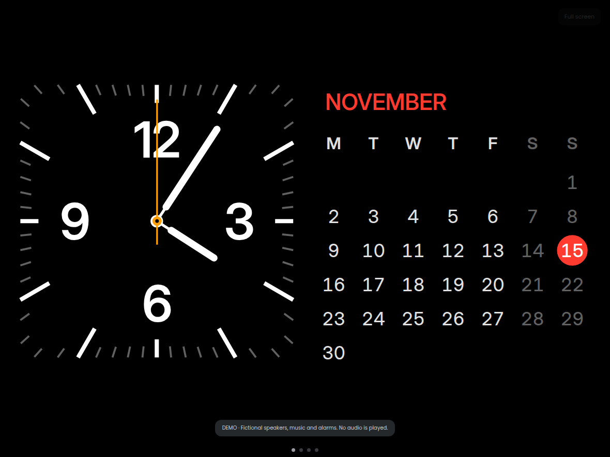

# Clock Radio

Four pages for Home Assistant tablets: **The Clock**, **Alarm configuration**,
**Music overview** and **Settings**. Nightstand-style clock faces and widgets,
Dasher's Music Assistant
browsing/player, and two independent HA-backed Music/Buzzer alarms.

Open it from the Home Assistant sidebar or at `http://<home-assistant>:8100/`.
The app connects to Home Assistant using Supervisor credentials; tablets never
receive those credentials. It controls your Home Assistant speakers and does
not play alarm audio in the browser. The optional **Preview sound** button
plays a short preview on the tablet/browser only.

Buzzer alarms can each select one of twelve original built-in sounds.
Update the HA alarm package to scheduler version 7 and configure a
speaker-accessible HA internal URL; see [sound setup](DOCS.md#buzzer-alarm-sounds).

## Screenshots

The Clock with an analog face and calendar, using fictional demo data:

See the [four-page screenshot gallery](https://github.com/JannicSJensen/ha-clock-radio#screenshots)
and the illustrated guide below for alarm editing, ringing screens and night mode.

See [documentation](DOCS.md) for configuration, safety and troubleshooting,
and [release notes](CHANGELOG.md) for updates.
